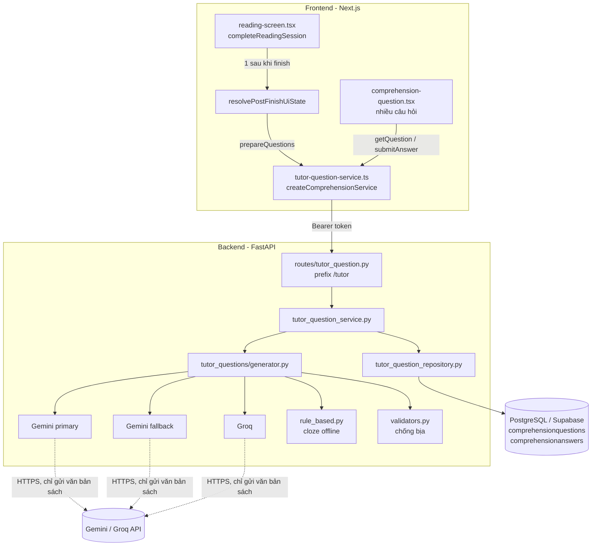
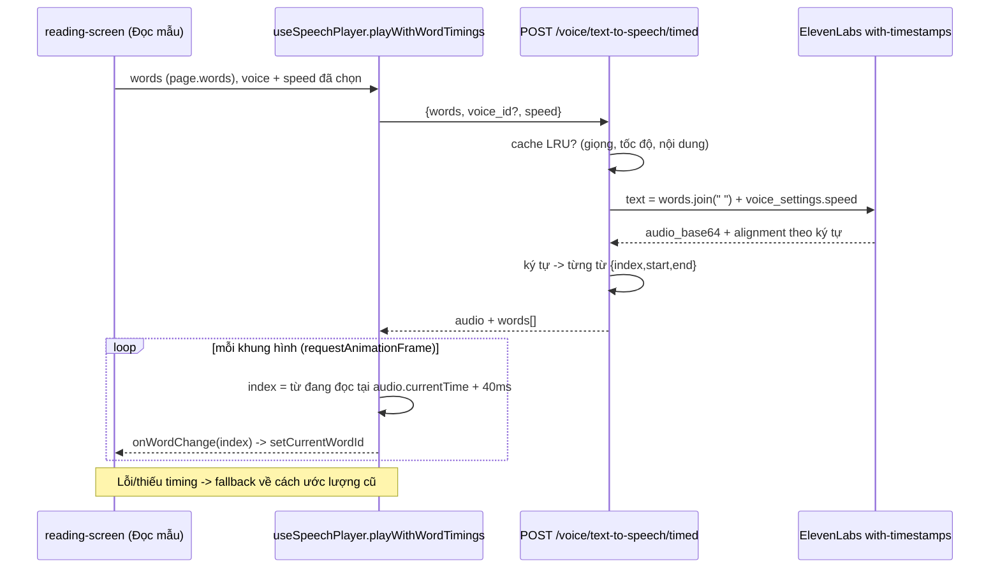
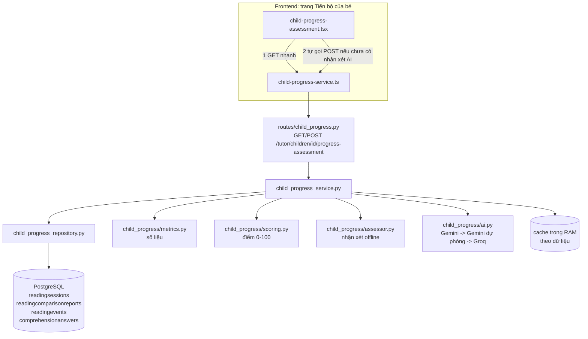

# Báo cáo chức năng: AI Tutor sinh câu hỏi sau khi bé đọc xong bài

> Nhánh phát triển: `tu` · Base: `origin/main` @ `7750082` · Ngày: 2026-11-09
> Trạng thái: đã code, đã có test tự động (backend + frontend). **Chưa chạy thử với Gemini/Groq thật và Supabase thật** (xem mục 10).

---

## 1. Mục tiêu và phạm vi

Sau khi bé bấm kết thúc buổi đọc, hệ thống tự tạo một bộ **câu hỏi đọc hiểu trắc nghiệm** (ngẫu nhiên **5–10 câu** mỗi bài, ít hơn nếu bài quá ngắn) dựa **duy nhất vào nội dung bé vừa đọc**. Bé trả lời lần lượt từng câu; sai thì được thử lại, đúng thì sang câu tiếp theo; xong thì sang màn hình hoàn thành buổi đọc.

Trước đây:

| Thành phần | Hiện trạng trước khi làm |
|---|---|
| Màn hình `ComprehensionQuestion` | Có UI nhưng `comprehensionService` luôn là "unavailable", và **không có chỗ nào chuyển sang state `question`** → bước này không bao giờ chạy |
| `POST /comprehension/questions` | Không xác thực, không qua service layer, không sinh câu hỏi |
| Bảng `comprehensionquestions/answers` | Đã có, lịch sử đọc (`/reading/history/{id}`) đã đọc được |

Phạm vi đã làm: sinh câu hỏi bằng AI + fallback, lưu DB, chấm điểm phía server, tích hợp luồng kết thúc buổi đọc, UI nhiều câu hỏi, test, tài liệu.
Ngoài phạm vi: câu hỏi mở (tự luận), nghe/đọc câu hỏi bằng TTS, hiển thị điểm đọc hiểu trong báo cáo phụ huynh (xem mục 11).

## 2. Tổng quan kiến trúc

Tuân thủ `BACKEND_FLOW_STANDARD.md`: **Router → Schema → Service → Repository → Model/ORM → PostgreSQL**.



### Vai trò từng lớp

| Lớp | File | Trách nhiệm |
|---|---|---|
| Router | `backend/app/api/routes/tutor_question.py` | 3 endpoint, xác thực (`get_current_parent_id`), không chứa nghiệp vụ |
| Schema | `backend/app/schemas/tutor_question.py` | DTO vào/ra. Payload cho bé **không có đáp án đúng** |
| Service | `backend/app/services/tutor_question_service.py` | Quyền sở hữu, điều kiện sinh, idempotent, chấm điểm, tiến độ |
| Generator | `backend/app/services/tutor_questions/` | Chuỗi provider AI + validate + fallback |
| Repository | `backend/app/repositories/tutor_question_repository.py` | Truy vấn/ghi DB, không có logic nghiệp vụ |
| Model | `models/comprehension.py` (có sẵn, **không sửa**) | `ComprehensionQuestion`, `ComprehensionAnswer` |

## 3. Công nghệ sử dụng

| Nhóm | Công nghệ |
|---|---|
| Backend | Python 3.12 (CI) / 3.10 (máy dev), FastAPI, SQLAlchemy 2.0 async + asyncpg, Pydantic v2, `httpx` (gọi AI) |
| AI | Google Gemini (`gemini-3.5-flash-lite` → `gemini-3.1-flash-lite`) với **structured output** (`responseJsonSchema`); Groq (`qwen/qwen3.8-27b`, `response_format: json_object`) |
| Fallback không cần AI | Thuật toán tạo câu hỏi điền từ (cloze) thuần Python, xác định (deterministic) |
| Database | PostgreSQL (Supabase), **không thêm migration**, tái sử dụng 2 bảng có sẵn |
| Frontend | Next.js 16, React 19, TypeScript, `zod` (validate response từ backend), `fetch` qua `requestApi` có sẵn |
| Test | `unittest` + `httpx.MockTransport` + `FastAPI TestClient` (backend); Vitest + Testing Library (frontend) |

Không thêm dependency mới ở cả backend lẫn frontend (không đụng các thư viện bị khóa theo `Agent.md`).

## 4. Cách hoạt động

### 4.1 Luồng end-to-end

1. Bé đọc xong → `completeReadingSession()` gọi `readingService.finish()` (REST) như cũ; session chuyển `COMPLETED`.
2. Ngay sau đó `resolvePostFinishUiState()` gọi `POST /tutor/sessions/{id}/questions/generate`.
3. Backend (service):
   1. Kiểm tra session **thuộc con của phụ huynh đang đăng nhập** (không thuộc → 404, giống "không tồn tại").
   2. Session phải đã kết thúc, nếu chưa → 409.
   3. Nếu đã có câu hỏi → trả lại luôn (**idempotent**, không tốn thêm lượt gọi AI).
   4. Gom văn bản các trang bé đã đọc (`readingsessionpages` trạng thái `COMPLETED`/`IN_PROGRESS`, lấy `VerifiedText` + từng từ `pagerevisionwords`).
   5. **Nhả transaction DB** trước khi gọi AI (project giới hạn số slot DB, không giữ kết nối trong lúc chờ mạng).
   6. Sinh câu hỏi (mục 4.2).
   7. Khóa dòng session (`FOR UPDATE`), kiểm tra lại đã có chưa (tránh 2 request song song cùng ghi), rồi lưu.
4. Frontend nhận `total > 0` → chuyển state `question`; ngược lại (lỗi, hết 45 giây, 0 câu) → **vào thẳng màn hình hoàn thành**, buổi đọc không bị ảnh hưởng.
5. `ComprehensionQuestion` gọi `GET .../questions/next` → hiển thị câu hỏi + các lựa chọn + "Câu 1/7" (số câu thay đổi theo từng bài).
6. Bé chọn đáp án → `POST .../questions/{qid}/answer` → server chấm, lưu `comprehensionanswers`, trả `is_correct`/`score`.
7. Đúng → nút "Câu tiếp theo" (câu cuối là "Hoàn thành") → tải câu kế tiếp; hết câu → màn hình hoàn thành.

### 4.2 Sinh câu hỏi (generator)

```
Gemini primary ──lỗi/0 câu hợp lệ──► Gemini fallback ──► Groq ──► Rule-based cloze
```

- Thứ tự thử tuần tự, không gọi song song, mỗi provider có timeout (`40s` mặc định).
- Nếu một nhà cung cấp trả **401/403/429/5xx** thì bỏ qua các model còn lại cùng nhà (cùng key/quota).
- **Số câu ngẫu nhiên**: mỗi lần sinh bốc ngẫu nhiên một số trong `[TUTOR_QUESTIONS_MIN_COUNT, TUTOR_QUESTIONS_MAX_COUNT]` (mặc định 5–10), rồi **giới hạn theo lượng văn bản bé đã đọc**: tối đa `số từ ÷ 8` câu (bài 40 từ → tối đa 5 câu, bài 80 từ trở lên mới đủ 10 câu, bài rất ngắn còn 1–2 câu), để không bị ép sinh câu hỏi trùng ý hoặc bịa. Prompt yêu cầu mỗi câu một ý khác nhau, trải đều các trang và trộn `FACTUAL`/`CLOZE`/`VOCABULARY`; `temperature` 0,7 để các lần sinh khác nhau. Nếu model trả ít hơn số yêu cầu (hoặc có câu bị validator loại), hệ thống dùng số câu hợp lệ còn lại.
- **Prompt** (tiếng Việt, `prompts.py`): chỉ dựa vào văn bản; câu hỏi ngắn phù hợp trẻ nhỏ; 3–4 lựa chọn, 1 đúng; loại `FACTUAL`/`CLOZE`/`VOCABULARY`; kèm `evidence` (trích nguyên văn) và `page_number`; văn bản nằm trong thẻ `<van_ban>` và được dặn là *dữ liệu, không phải chỉ dẫn* (giảm prompt injection).
- **Validate nghiêm ngặt** (`validators.py`) – mỗi câu bị loại nếu:
  - sai type/độ khó, prompt rỗng hoặc quá dài, không có 3–4 lựa chọn, lựa chọn trùng/quá dài, `correct_index` sai kiểu hoặc ngoài khoảng, CLOZE thiếu `____`;
  - **`evidence` không xuất hiện nguyên văn trong văn bản bé đã đọc** (chống AI bịa chi tiết). Vị trí tìm được cũng được dùng để tính `source_span`.
- Lựa chọn được **xáo trộn có seed ổn định** để đáp án đúng không luôn đứng đầu.
- **Rule-based** (`rule_based.py`): chọn câu 5–18 từ, che 1 từ nội dung (loại stopword), 3 đáp án nhiễu lấy từ chính bài đọc (ưu tiên độ dài gần nhau). Hoạt động hoàn toàn offline → bé luôn có bài tập ngay cả khi hết quota AI hoặc chưa cấu hình key.

### 4.3 Chấm điểm

Chấm **ở server**: so sánh `normalize_text(answer)` (NFC, chữ thường, bỏ dấu câu, **giữ dấu thanh tiếng Việt**) với đáp án đúng + `acceptedanswers`. Lưu mỗi lần thử vào `comprehensionanswers` (`iscorrect`, `score` 1.0/0.0). Sau khi đã đúng, gửi lại không tạo bản ghi mâu thuẫn. Lịch sử đọc (`/reading/history`) lấy bản trả lời mới nhất như hiện tại.

### 4.4 Trải nghiệm trên giao diện

- **Hover**: đáp án còn chọn được sẽ nổi nhẹ, viền đậm màu chính, nền kem và chữ in đậm hơn. Đáp án đã khóa sau khi đúng thì không có hiệu ứng này.
- **Trả lời sai**: đáp án vừa chọn đổi sang viền/nền cảnh báo, bé chọn lại được.
- **Trả lời đúng**: đáp án chuyển nền xanh kèm dấu tick, đồng thời **bắn pháo hoa toàn màn hình** (`components/reading/fireworks-burst.tsx`): canvas 2D, 7 loạt pháo nổ liên tiếp ở các vị trí ngẫu nhiên, hạt có trọng lực và vệt sáng mờ dần. Canvas `pointer-events: none`, ẩn với trình đọc màn hình, tự dọn (animation frame, timer, listener) khi xong hoặc khi rời màn hình; tắt hoàn toàn nếu hệ điều hành bật "giảm chuyển động". Không thêm thư viện nào.

## 5. API

Tất cả cần `Authorization: Bearer <Supabase access token>`; parent phải sở hữu session.

| Method | Endpoint | Mô tả | Response |
|---|---|---|---|
| POST | `/tutor/sessions/{session_id}/questions/generate` | Tạo câu hỏi cho session đã kết thúc (idempotent) | `{session_id, total, source: "AI"\|"RULE_BASED"\|null, created}` |
| GET | `/tutor/sessions/{session_id}/questions/next` | Câu chưa trả lời đúng kế tiếp | `{question, choices[{id,label,value}], progress_label, position, total, completed}` |
| POST | `/tutor/sessions/{session_id}/questions/{question_id}/answer` | Gửi đáp án `{answer}` (1–200 ký tự, không field thừa) | `{answer_id, question_id, submitted_answer, is_correct, score, feedback_code: "CORRECT"\|"TRY_AGAIN"}` |

Mã lỗi: 401 chưa đăng nhập · 404 session/câu hỏi không thuộc người dùng hoặc không tồn tại · 409 session chưa kết thúc · 422 body sai.

## 6. Dữ liệu

**Không có migration mới** (tránh xung đột thứ tự migration và tránh phụ thuộc việc chạy migration trước khi deploy). Ánh xạ vào `comprehensionquestions`:

| Cột | Giá trị |
|---|---|
| `type` | `FACTUAL` / `CLOZE` / `VOCABULARY` |
| `prompt` | Nội dung câu hỏi |
| `expectedanswer` | Văn bản lựa chọn đúng (**không bao giờ trả về client**) |
| `acceptedanswers` | `[normalize(đáp án đúng)]` |
| `difficulty` | `EASY`/`MEDIUM`/`HARD` (API trả 1/2/3) |
| `sourcespan` (JSONB) | `{start_word_index, end_word_index_exclusive, sentence_index, choices[], generation:{source, provider}}` |
| `pageid`, `pagerevisionid` | Trang/phiên bản chứa bằng chứng |
| `createdat` | Tăng dần theo từng micro-giây để giữ đúng thứ tự câu hỏi |

Danh sách lựa chọn và nguồn sinh được lưu **trong JSONB `sourcespan`** (các key thừa được bộ đọc lịch sử hiện tại bỏ qua an toàn). Các dòng cũ không có `choices` (tạo bởi API cũ) bị bỏ qua trong luồng này.
Lý do chọn cách này thay vì thêm cột: ORM `SELECT` mọi cột của model, nên một cột mới chưa được migrate sẽ làm hỏng cả màn hình lịch sử đọc đang chạy.

## 7. Cấu hình (chỉ đọc ở backend)

| Biến môi trường | Mặc định | Ý nghĩa |
|---|---|---|
| `TUTOR_QUESTIONS_ENABLED` | `true` | Tắt hẳn tính năng (generate trả 0 câu → bé vào thẳng màn hoàn thành) |
| `TUTOR_QUESTIONS_AI_ENABLED` | `true` | `false` → chỉ dùng rule-based |
| `GEMINI_API_KEY`, `GROQ_API_KEY` | – | **Dùng lại** key đang có cho OCR; thiếu key thì provider đó bị bỏ qua |
| `TUTOR_QUESTIONS_GEMINI_MODEL` / `_GEMINI_FALLBACK_MODEL` / `_GROQ_MODEL` | `gemini-3.5-flash-lite` / `gemini-3.1-flash-lite` / `qwen/qwen3.8-27b` | Tên model |
| `TUTOR_QUESTIONS_TIMEOUT_SECONDS` | `40` (1–120) | Timeout mỗi provider (10 câu cần nhiều thời gian hơn 3 câu) |
| `TUTOR_QUESTIONS_MIN_COUNT` / `TUTOR_QUESTIONS_MAX_COUNT` | `5` / `10` (1–15) | Khoảng số câu ngẫu nhiên mỗi bài; nếu MAX < MIN thì MAX = MIN; đặt hai giá trị bằng nhau để cố định số câu |
| `TUTOR_QUESTIONS_MAX_SOURCE_CHARS` | `6000` | Giới hạn văn bản gửi AI (kiểm soát chi phí) |

Giá trị sai/không hợp lệ tự rơi về mặc định (không làm sập server khi khởi động).

## 8. Bảo mật và quyền riêng tư

- **Xác thực + sở hữu**: mọi endpoint dùng `get_current_parent_id`; truy vấn join `childprofiles.parentid` → phụ huynh khác nhận 404 (không lộ sự tồn tại session).
- **Không lộ đáp án**: schema trả về cho bé không có `expected_answer`; test kiểm tra payload.
- **API key chỉ ở backend**, gửi qua header (`x-goog-api-key`, `Authorization`) – không nằm trong URL/body/log (có test).
- **Dữ liệu gửi cho AI**: chỉ văn bản sách đã được admin xác minh. **Không** gửi tên/ID bé, phụ huynh, session, token.
- **Lỗi nhà cung cấp** được map sang mã nội bộ (`PROVIDER_QUOTA`, `INVALID_RESPONSE`…), không chép nội dung phản hồi của vendor vào exception/log.
- **Chống bịa/an toàn nội dung**: bắt buộc `evidence` nằm trong bài; prompt cấm nội dung bạo lực/người lớn; giới hạn độ dài prompt/lựa chọn.
- Giới hạn chi phí: idempotent theo session, tối đa 10 câu mỗi bài (mặc định), cắt văn bản ở 6000 ký tự, timeout mỗi provider.

## 9. Xử lý lỗi và độ tin cậy

| Tình huống | Hành vi |
|---|---|
| Không có key / tắt AI / hết quota / AI trả sai định dạng / AI bịa | Chuyển sang provider kế tiếp, cuối cùng dùng rule-based |
| Văn bản quá ngắn, không tạo được câu | `total = 0` → bé vào thẳng màn hoàn thành |
| Backend lỗi, mất mạng, quá 45 giây | Frontend bắt lỗi, vào màn hoàn thành; session đã kết thúc từ trước nên không mất dữ liệu |
| Hai request generate cùng lúc | Khóa `FOR UPDATE` + kiểm tra lại → chỉ một bộ câu hỏi được lưu |
| Tải câu hỏi lỗi giữa chừng | UI hiện nút "Thử lại", không ảnh hưởng buổi đọc |
| Gọi lại `generate` sau khi reload | Trả bộ câu hỏi cũ, không gọi AI lần nữa |

## 10. Kiểm thử

| Bộ test | Kết quả |
|---|---|
| `backend/test_tutor_questions.py` (mới, 29 test, gồm khoảng số câu ngẫu nhiên, giới hạn theo độ dài bài và cấu hình môi trường) | **OK** |
| Toàn bộ backend `python -m unittest discover` (461 test) | 1 lỗi: `test_database_session.test_limit_waits_then_times_out_without_over_acquiring` — **không liên quan thay đổi này**: file `app/database/session.py` không bị sửa; lỗi do `asyncio.wait_for` ném `asyncio.TimeoutError` trên Python 3.10 (máy dev) (`except TimeoutError` chỉ bắt được từ Python 3.11), trong khi CI chạy Python 3.12 |
| Frontend `npx vitest run` | **85 file, 700 test, tất cả pass** (gồm 3 file mới, 13 test) |
| `npx tsc --noEmit` | 0 lỗi |
| ESLint các file thay đổi | 0 lỗi/cảnh báo |
| Prettier các file thay đổi | Đạt |

Phạm vi test mới: validator (hợp lệ, bịa evidence, dữ liệu sai, dedupe, xáo trộn ổn định) · rule-based (xác định, chỉ dùng từ trong bài) · provider qua `httpx.MockTransport` (key chỉ trong header, phân loại lỗi 401/429/5xx, JSON hỏng) · generator (Gemini 429 → bỏ qua model cùng nhà → Groq, AI bịa → rule-based, không key thì không dùng mạng) · service với repository giả (404 cho phụ huynh khác, 409 khi chưa kết thúc, idempotent, nhả DB trước khi gọi AI, chấm điểm, không lộ đáp án, bỏ qua dòng cũ) · route (401, validate body, ủy quyền cho service) · frontend service (đường dẫn, header, zod, map dữ liệu), helper sau khi kết thúc (timeout, lỗi), UI nhiều câu (thử lại khi sai, chuyển câu, hoàn thành, tương thích nguồn một câu).

**Chưa kiểm chứng (cần làm thủ công trước khi demo):**
- Gọi thật Gemini/Groq bằng key thật (đã chạy qua mock transport).
- Chạy với Supabase/PostgreSQL thật (đã chạy qua repository giả; câu truy vấn `FOR UPDATE ... OF` và thứ tự `createdat` cần xác nhận trên DB thật).
- Chạy trình duyệt end-to-end (Playwright) từ lúc kết thúc bài đọc đến màn hình câu hỏi.
- Chưa thêm test tích hợp cho `reading-screen.tsx` (bước chuyển sang state `question`); logic quyết định đã được test riêng ở `resolvePostFinishUiState`.

## 11. Danh sách file

**File mới (không thể xung đột khi merge):**

```
backend/app/api/routes/tutor_question.py
backend/app/schemas/tutor_question.py
backend/app/repositories/tutor_question_repository.py
backend/app/services/tutor_question_service.py
backend/app/services/tutor_questions/{__init__,config,types,prompts,text_utils,validators,providers,rule_based,generator}.py
backend/test_tutor_questions.py
frontend/lib/api/tutor-question-service.ts
frontend/lib/reading/post-finish-questions.ts
frontend/components/reading/fireworks-burst.tsx
frontend/tests/reading/{tutor-question-service.test.ts, post-finish-questions.test.ts, comprehension-question-flow.test.tsx}
docs/AI_TUTOR_QUESTIONS_REPORT.md
```

**File có sẵn được sửa (nhỏ, cục bộ):**

| File | Thay đổi |
|---|---|
| `backend/app/api/router.py` | +3 dòng: import và `include_router(prefix="/tutor")` |
| `frontend/components/providers/app-services-provider.tsx` | Gắn `createComprehensionService()` thay cho service "unavailable" (cùng cơ chế `isReadingEnabled` như các service khác) + 1 import |
| `frontend/components/reading/reading-screen.tsx` | 1 import + thay `setUiState("complete")` bằng `setUiState(await resolvePostFinishUiState(...))` |
| `frontend/components/reading/comprehension-question.tsx` | Hỗ trợ nhiều câu: tải câu tiếp theo, thanh tiến độ động, nút "Hoàn thành" |
| `frontend/lib/api/comprehension-service.ts` | Thêm phương thức **tùy chọn** `prepareQuestions?` |
| `frontend/types/reading.ts` | Thêm 2 field **tùy chọn** `position?`, `total?` vào view model |

Các thay đổi trên file có sẵn đều **tương thích ngược** (field/method tùy chọn) nên không phải sửa test cũ; toàn bộ test cũ vẫn pass.

### Rủi ro xung đột khi merge vào `main`

- `origin/main` hiện là `7750082` và là tổ tiên của `tu` → merge sẽ là fast-forward cho đến khi `main` có commit mới.
- Không có migration, không sửa model, không sửa `package.json`/`requirements.txt`, không format lại file nào.
- Đã quét các nhánh remote chưa merge: chỉ `fix/ocr-confidence-calibration-20261104` (sửa `reading-screen.tsx`) và `feature/ocr-layout-and-retired-page-visibility-20261016` (sửa `types/reading.ts`) chạm cùng file, nhưng các hunk của họ cách xa các dòng mình sửa (mình sửa ở dòng ~9 và ~3070 của `reading-screen.tsx`; ở `types/reading.ts` ngay dưới `ComprehensionQuestionViewModelUI`) nên git sẽ tự gộp được.
- Điểm có xác suất xung đột cao nhất nếu `main` đổi tiếp: cuối file `router.py` (nếu ai đó cũng thêm router vào đúng chỗ cuối file) và import block của `app-services-provider.tsx`.

## 12. Hạn chế và hướng phát triển

- Chỉ câu hỏi **trắc nghiệm**; chưa có câu hỏi mở và chấm bằng AI.
- Câu hỏi sinh một lần cho mỗi session; chưa có nút "tạo lại" cho phụ huynh.
- Câu hỏi chưa được đọc to bằng TTS (hạ tầng ElevenLabs đã có sẵn trong dự án để nối vào).
- Chưa đưa `comprehension_accuracy` thật vào báo cáo tiến bộ phụ huynh (hiện logic ở `system.py` vẫn dựa vào luồng cũ); dữ liệu câu trả lời đã nằm đủ trong `comprehensionanswers`.
- Nên đề xuất lâu dài một migration thêm cột `choices JSONB` và `generation JSONB` thay vì dùng `sourcespan`, khi đội DB sẵn sàng chạy migration đồng bộ.
- Các endpoint cũ `/comprehension/*` **không có xác thực** (có từ trước): nên được khóa hoặc loại bỏ trong một thay đổi riêng, tính năng mới không phụ thuộc vào chúng.
- Không giới hạn tần suất (rate limit) ngoài tính idempotent; nếu mở rộng, nên thêm giới hạn theo phụ huynh.

## 13. Cách chạy và kiểm tra

```powershell
# Backend (từ thư mục backend)
python -m unittest test_tutor_questions

# Frontend (từ thư mục frontend)
npx vitest run tests/reading/tutor-question-service.test.ts tests/reading/post-finish-questions.test.ts tests/reading/comprehension-question-flow.test.tsx
npx tsc --noEmit
```

Chạy thử tay: cấu hình `GEMINI_API_KEY` (và/hoặc `GROQ_API_KEY`) trong `backend/.env`, khởi động backend/frontend như `Agent.md`, đọc một trang đã được admin xác minh rồi bấm kết thúc. Không có key thì bé vẫn nhận được câu hỏi điền từ (`source = "RULE_BASED"`).

---

# Phụ lục: Đọc mẫu khớp từng từ và chọn giọng đọc ElevenLabs

> Cùng nhánh `tu`, làm sau tính năng câu hỏi. Mục tiêu: dấu tô từ trên màn hình đọc phải trùng với giọng đọc mẫu, và cho phép đổi giọng/tốc độ.

## A. Vấn đề trước đây

`handleReadSample` **ước lượng** từ đang đọc bằng cách lấy `currentTime / duration` nhân với "trọng số" độ dài ký tự của các từ. Cách này lệch khi giọng đọc nghỉ ở dấu câu, đọc nhanh/chậm không đều, đoạn im lặng đầu/cuối file mp3, nên dấu tô chạy sớm hoặc muộn so với tiếng.

## B. Giải pháp

Dùng endpoint `POST /v1/text-to-speech/{voice_id}/with-timestamps` của ElevenLabs: trả về âm thanh **kèm thời điểm bắt đầu/kết thúc của từng ký tự**. Backend ghép các ký tự thành từng từ, frontend tô theo **đồng hồ của chính file audio** (`audio.currentTime`) thay vì ước lượng.



### Các điểm chính

- **Khớp chính xác**: backend gửi `words.join(" ")` nên biết trước khoảng ký tự của từng từ; mốc của từ = bắt đầu ký tự đầu, kết thúc ký tự cuối. Mốc luôn **không giảm** để dấu tô chỉ đi tới. Chỉ số trả về trùng chỉ số trong `page.words`, nên không cần dò chữ.
- **Tô sớm 40 ms** (`HIGHLIGHT_LEAD_SECONDS`) để bù độ trễ vẽ khung hình (~16 ms) và bộ đệm âm thanh; tra từ bằng tìm kiếm nhị phân (`findActiveWordIndex`).
- **Đúng với mọi tốc độ**: tốc độ được áp dụng ngay khi tổng hợp (`voice_settings.speed`, 0.7–1.2), nên mốc thời gian của ElevenLabs đã phản ánh tốc độ đó. (Đo thật: câu 11 từ dài 3,48 s ở 0,8× và 2,83 s ở 1,1×.)
- **Nhanh hơn khi nghe lại**: backend có bộ nhớ đệm LRU (24 mục / 32 MB) theo (giọng, model, tốc độ, nội dung) và frontend giữ 6 trang gần nhất, nên bấm "Đọc mẫu" lần hai gần như tức thì và **không tốn thêm ký tự ElevenLabs**.
- **Không làm kém đi**: nếu endpoint lỗi, hết quota, thiếu mốc thời gian hoặc số từ không khớp, player gọi lại đường cũ (`synthesize` + ước lượng, rồi giọng thiết bị). Sau một lần lỗi, dịch vụ timing được nghỉ 30 giây để không làm chậm lần bấm tiếp theo.

## C. Chọn giọng và tốc độ

- **Danh sách giọng**: `GET /voice/voices` gọi `GET /v2/voices` của ElevenLabs (tối đa 5 trang, có chặn vòng lặp), lọc chỉ giữ trường an toàn (tên, giới tính, giọng vùng miền, độ tuổi, mô tả), cache 10 phút. Tài khoản hiện tại có 21 giọng.
- **Giao diện** (`reading-voice-settings.tsx`): nút "Giọng đọc" nằm ngay sau nút "Đọc cả đoạn" trong thanh điều khiển ở cuối màn hình đọc, mở hộp thoại gồm thanh trượt tốc độ 0,70×–1,20× với 3 mức nhanh (Chậm 0,8 / Vừa 0,9 / Nhanh 1,1), danh sách giọng (radio, có dấu tick), nút "Nghe thử" đọc một câu mẫu bằng chính giọng và tốc độ vừa chọn. Nút bị khóa khi micro đang thu để âm thanh nghe thử không lọt vào bài đọc của bé.
- **Ghi nhớ**: lựa chọn lưu ở `localStorage` của trình duyệt (`viread.speech-preferences.v1`), đã kiểm tra lại giá trị khi đọc (chặn dữ liệu bị sửa), mặc định tốc độ **0,9×** (chậm hơn bình thường một chút cho trẻ nhỏ). Giọng được áp dụng cho cả đọc mẫu cả đoạn, đọc một từ và các câu hướng dẫn.

## D. API mới

| Method | Endpoint | Request | Response |
|---|---|---|---|
| GET | `/voice/voices` | – | `{voices:[{voice_id,name,category,gender,accent,age,use_case,description,preview_url}], default_voice_id}` |
| POST | `/voice/text-to-speech/timed` | `{words:[string] (1–800, không chứa khoảng trắng), voice_id?, speed: 0.7–1.2}` | `{audio_base64, content_type, duration_seconds, words:[{index,start,end}]}` |

Cả hai yêu cầu đăng nhập; lỗi nhà cung cấp chỉ trả `{"detail":{"code":"SPEECH_UNAVAILABLE"}}` (không lộ nội dung phản hồi của ElevenLabs). Endpoint cũ `/voice/text-to-speech` giữ nguyên.

## E. File

**Mới:**

```
backend/app/providers/elevenlabs_studio_provider.py   # danh sách giọng, tổng hợp có mốc từ, cache
backend/app/schemas/voice_studio.py
backend/app/api/routes/voice_studio.py
backend/test_voice_studio.py
frontend/lib/api/voice-studio-service.ts
frontend/lib/reading/speech-preferences.ts
frontend/lib/reading/word-timeline.ts
frontend/hooks/use-speech-preferences.ts
frontend/components/reading/reading-voice-settings.tsx
frontend/tests/reading/{word-timeline, speech-preferences, voice-studio-service, word-timed-playback, reading-voice-settings}.test.ts(x)
```

**Sửa file có sẵn (nhỏ, cục bộ):** `backend/app/api/router.py` (+2 dòng), `frontend/hooks/use-speech-player.ts` (thêm `playWithWordTimings`, và truyền `voiceId` đã chọn vào `synthesize`), `frontend/components/reading/reading-layout.tsx` và `reading-controls.tsx` (thêm prop tùy chọn `voiceSettings`; thanh điều khiển tự chuyển từ 5 sang 6 cột khi có nút này), `frontend/components/reading/reading-screen.tsx` (đọc mẫu gọi `playWithWordTimings` với đường cũ làm fallback; gắn nút giọng đọc). Provider cũ `elevenlabs_voice_provider.py` **không bị sửa** (lớp mới kế thừa nó).

## F. Kiểm thử

| Bộ test | Kết quả |
|---|---|
| `backend/test_voice_studio.py` (mới, 17 test) | OK |
| Toàn bộ backend (478 test) | 1 lỗi cũ không liên quan (`test_database_session`, do Python 3.10 như mục 10) |
| Frontend `npx vitest run` | **91 file, 728 test pass** |
| `tsc --noEmit`, ESLint, Prettier trên file thay đổi | 0 lỗi |
| Gọi thật ElevenLabs (danh sách giọng, `with-timestamps` ở 0,8× và 1,1×, cache) | Đạt: 21 giọng, mốc từ tăng dần, lần gọi lặp lại trúng cache |

Việc gọi API thật phát hiện một lỗi mà test giả lập không thấy được (đường dẫn `/v1/v2/voices` thay vì `/v2/voices`); đã sửa và có test khóa đường dẫn.

Phạm vi test: ánh xạ ký tự → từ (chính xác, đơn điệu, dữ liệu sai), lọc dữ liệu giọng, phân trang/cache/giới hạn trang, cache âm thanh theo giọng và tốc độ, ánh xạ lỗi nhà cung cấp, validate request (tốc độ, từ chứa khoảng trắng, độ dài), xác thực; phía frontend: tìm từ theo thời gian (so với duyệt tuyến tính), lưu/chặn dữ liệu sai trong `localStorage`, service, **player tô từng từ đúng thứ tự theo đồng hồ audio**, dùng đúng giọng/tốc độ, cache, fallback, không fallback khi người dùng dừng giữa chừng, và hộp thoại chọn giọng.

## G. Hạn chế

- **Chưa kiểm chứng bằng tai và mắt trên màn hình đọc thật** (cần đăng nhập). Cần nghe thử vài trang để chỉnh `HIGHLIGHT_LEAD_SECONDS` nếu thiết bị có độ trễ âm thanh lớn (Bluetooth).
- Độ trễ lần đầu bấm "Đọc mẫu" vẫn là thời gian ElevenLabs tổng hợp cả trang (vài giây với trang dài); từ lần hai nhờ cache. Chưa tải trước âm thanh để không tốn ký tự khi bé không bấm.
- Giới hạn một yêu cầu: 800 từ / 5.000 ký tự.
- Tất cả giọng ElevenLabs của tài khoản đều hiện ra, kể cả giọng chưa được xác nhận đọc tiếng Việt tốt (mô hình `eleven_flash_v2_5` hỗ trợ tiếng Việt cho mọi giọng nhưng chất lượng khác nhau); nên chọn "Nghe thử" trước.
- Lựa chọn giọng/tốc độ lưu theo trình duyệt, chưa lưu theo hồ sơ của bé trên server.

## Cập nhật: số câu hỏi ngẫu nhiên 5–10 mỗi bài

- Kiểm tra key Gemini: hoạt động. Cả ba bộ câu hỏi đã lưu trong DB từ lúc bạn thử (2–3 câu) đều có `generation.source = AI`, `provider = gemini-primary`, tức là do Gemini sinh chứ không phải fallback điền từ.
- Thử thật với truyện ngắn 2 trang (131 từ), 3 lần: 6, 5, 5 câu, trộn đủ `FACTUAL`/`CLOZE`/`VOCABULARY`, mỗi lần 3,5–5,4 giây, câu hỏi bám đúng bài. Với văn bản đủ dài số câu có thể lên tới 10.
- Điểm cần lưu ý: Gemini nhận yêu cầu "đúng N câu" nhưng đôi khi trả ít hơn, và validator loại câu có trích dẫn không nằm trong bài, nên số câu thực tế có thể thấp hơn số bốc ngẫu nhiên. Chưa làm bước "bù thêm" bằng câu điền từ tự tạo.

---

# Phụ lục: Tiến bộ của bé, đánh giá, chấm điểm và nhận xét bằng AI

> Cùng nhánh `tu`. Mục tiêu: ba mẹ mở trang "Tiến bộ của bé" là thấy ngay bé đang đọc tốt ở đâu, yếu ở đâu và cần làm gì để tốt hơn, dựa trên dữ liệu đọc thật của bé.

## A. Vấn đề trước đây

Màn hình "Tiến bộ của bé" chỉ hiển thị các dòng đã lưu sẵn trong bảng `progressreports`. Không có đoạn code nào tạo ra các dòng đó, nên phần lớn bé thấy "Chưa có báo cáo đã lưu". Dữ liệu đọc thật (`readingsessions`, `readingcomparisonreports`, `readingevents`, `comprehensionanswers`) có nhưng không được tổng hợp, và không có đánh giá hay lời khuyên nào.

## B. Nguyên tắc thiết kế

1. **Điểm do hệ thống tính, AI chỉ viết nhận xét.** Điểm là công thức minh bạch trên dữ liệu thật; AI không được tự chấm hay đổi điểm, nên điểm giống nhau giữa các lần và có thể giải thích được.
2. **Luôn có kết quả.** Nếu AI lỗi, hết quota hoặc chưa có key, hệ thống tự sinh nhận xét từ số liệu (nguồn `RULE_BASED`) và gắn nhãn rõ "Nhận xét tự động".
3. **Tiết kiệm chi phí**: chỉ gọi AI khi cần; kết quả được cache theo dữ liệu, dữ liệu không đổi thì không gọi lại.
4. **Riêng tư**: chỉ gửi cho AI các số liệu tổng hợp và các từ khó của sách; không gửi tên bé, ID, tên phụ huynh hay nội dung lời nói.

## C. Kiến trúc



Tuân thủ `BACKEND_FLOW_STANDARD.md`: Router -> Schema -> Service -> Repository -> Model -> PostgreSQL. Repository chỉ có truy vấn đọc; transaction DB được nhả trước khi gọi AI.

## D. Cách hoạt động

1. Frontend gọi `GET` -> backend tính số liệu và điểm (khoảng 2 giây) và trả ngay kèm nhận xét AI đã cache hoặc nhận xét offline.
2. Nếu chưa có nhận xét AI, frontend tự gọi `POST`; trong lúc chờ, điểm và nhận xét offline vẫn hiển thị và nút báo "AI đang viết nhận xét…". Xong thì nhận xét AI thay thế.
3. Kỳ đánh giá chọn 7/30/90 ngày (theo giờ Việt Nam), so sánh với kỳ liền trước cùng độ dài để cho biết tăng hay giảm.

### Số liệu (`metrics.py`, hàm thuần, có test)

| Nhóm | Cách tính |
|---|---|
| Đọc đúng | Từ bảng so sánh lời đọc với văn bản (MATCH/SUBSTITUTE/DELETE/INSERT). **Từ nằm sau từ cuối cùng bé đọc tới không bị tính là sai** (bé chưa đọc tới); chỉ tính bỏ sót các từ trước đó. Độ chính xác = số từ đúng / số từ đã đọc tới |
| Phủ trang | Số từ đã đọc tới / tổng số từ của trang |
| Đọc nhầm, bỏ sót | Tỉ lệ trên số từ đã đọc tới |
| Ngập ngừng, lặp từ | Số lần dừng lâu hơn 1 giây và số lần lặp từ trong báo cáo so sánh |
| Hiểu bài | **Chỉ tính lần trả lời đầu tiên** của mỗi câu hỏi (thử lại không làm lần đầu tốt hơn); thống kê theo loại câu hỏi |
| Chăm chỉ | Số ngày có buổi đọc hoàn thành, số buổi, số phút (mỗi buổi tối đa 90 phút để buổi bị quên đóng không làm sai số) |
| Từ khó | Từ bé hay đọc nhầm hoặc bỏ sót nhiều nhất, kèm từ bé thường đọc thành |
| Luyện từ | Số lần đọc lại đúng/sai từng từ |

### Điểm (`scoring.py`)

| Thành phần | Công thức | Trọng số |
|---|---|---|
| Đọc đúng | % từ đọc đúng (cần ít nhất 20 từ) | 40% |
| Hiểu bài | % câu trả lời đúng lần đầu (cần ít nhất 3 câu) | 25% |
| Đọc trôi chảy | 100 trừ 5 điểm cho mỗi lần ngập ngừng/lặp từ trên 100 từ | 20% |
| Chăm chỉ | ngày có đọc / mục tiêu 3 ngày mỗi tuần, tối đa 100 | 15% |

Điểm tổng là trung bình có trọng số **trên các thành phần có dữ liệu** (trọng số được chuẩn hóa lại), và cần có dữ liệu đọc đúng hoặc hiểu bài (chỉ đi học đều chưa phải điểm đọc). Xếp loại: từ 85 Xuất sắc, từ 70 Tốt, từ 55 Khá, dưới 55 Cần luyện thêm. Thiếu dữ liệu thì hiện "Chưa đủ dữ liệu", không đoán.

### Nhận xét AI (`ai.py`)

- Chuỗi: Gemini chính -> Gemini dự phòng -> Groq. Lỗi khóa/hết quota thì bỏ cả họ model; lỗi quá tải 5xx thì vẫn thử model dự phòng. Timeout 20 giây mỗi lần.
- Dùng structured output (JSON schema). Prompt yêu cầu: chỉ dùng số liệu được cung cấp, mỗi điểm yếu phải kèm bằng chứng bằng số, gợi ý làm được tại nhà trong 5–15 phút, không chẩn đoán y khoa, gọi trẻ là "bé" và người đọc là "ba mẹ", nói rõ khi dữ liệu thiếu.
- Kết quả được **kiểm tra và làm sạch**: giới hạn độ dài, loại gợi ý sai đối tượng, và chỉ giữ từ luyện tập nằm trong danh sách từ khó thật. Nếu thiếu phần cốt lõi thì coi như lỗi và dùng nhận xét offline.
- Nội dung nhận xét: tiêu đề, tóm tắt, điểm bé làm tốt, điểm cần cải thiện (kèm bằng chứng), việc ba mẹ làm và việc bé làm, từ nên luyện thêm, một câu động viên cho bé.

### Cache

Khóa cache = (bé, số ngày, dấu vân tay của toàn bộ số liệu). Số liệu không đổi thì trả lại nhận xét cũ (không tốn lượt gọi AI); có buổi đọc mới thì tự tạo nhận xét mới. Nút "Nhờ AI nhận xét lại" có thời gian chờ 60 giây để tránh bấm liên tục. Cache nằm trong RAM của backend, hết hạn sau 24 giờ.

## E. API

Đều cần đăng nhập; phụ huynh chỉ xem được bé của mình (sai chủ thì trả 404).

| Method | Endpoint | Mô tả |
|---|---|---|
| GET | `/tutor/children/{child_id}/progress-assessment?days=7..90` | Điểm, số liệu, biểu đồ tuần, từ khó và nhận xét (AI đã cache hoặc offline). Không gọi AI |
| POST | `/tutor/children/{child_id}/progress-assessment` body `{days, refresh}` | Gọi AI viết nhận xét (có cache); `refresh` bắt AI viết lại |

Kết quả chứa: `data_status` (`OK`/`INSUFFICIENT`), `score` (tổng, xếp loại, thay đổi so với kỳ trước, 4 thành phần), `metrics`, `weekly`, `difficult_words`, `assessment` (`source` = `AI`/`RULE_BASED`, `model`), `ai_cached`.

## F. Giao diện

Thẻ "Đánh giá bằng AI" nằm đầu trang Tiến bộ của bé (trước phần báo cáo đã lưu), gồm: chọn kỳ 7/30/90 ngày, vòng tròn điểm tổng kèm xếp loại và mũi tên tăng/giảm so với kỳ trước, 4 thanh điểm thành phần kèm giải thích, 4 ô thống kê (buổi đọc, phút, từ đã đọc, % đọc đúng), biểu đồ phút đọc theo tuần kèm % đọc đúng, khung nhận xét (có nhãn "Nhận xét do AI viết" hoặc "Nhận xét tự động từ số liệu"), các mục Bé làm tốt, Bé cần cải thiện, Cần làm gì (chia việc cho ba mẹ và việc cho bé), Từ bé nên luyện thêm và câu động viên. Có trạng thái đang tải, lỗi kèm nút thử lại, và hỗ trợ trình đọc màn hình (`progressbar`, `aria-live`, bảng tóm tắt cho biểu đồ). Thẻ chỉ hiển thị khi service được cung cấp, nên các màn hình/test hiện có không bị ảnh hưởng.

## G. Công nghệ

Backend: FastAPI, SQLAlchemy async (chỉ truy vấn đọc), Pydantic v2, `httpx` gọi Gemini/Groq (cùng khóa `GEMINI_API_KEY`/`GROQ_API_KEY` đang dùng cho tính năng khác). Frontend: React 19, TypeScript, `zod`, Tailwind, SVG tự vẽ cho vòng điểm (không thêm thư viện).

Cấu hình (`backend/.env`, đều có mặc định): `CHILD_PROGRESS_AI_ENABLED` (true), `CHILD_PROGRESS_GEMINI_MODEL` / `_GEMINI_FALLBACK_MODEL` / `_GROQ_MODEL`, `CHILD_PROGRESS_TIMEOUT_SECONDS` (20), `CHILD_PROGRESS_CACHE_TTL_SECONDS` (86400), `CHILD_PROGRESS_REFRESH_COOLDOWN_SECONDS` (60). Không có migration mới.

## H. File

**Mới:**

```
backend/app/schemas/child_progress.py
backend/app/repositories/child_progress_repository.py
backend/app/services/child_progress_service.py
backend/app/services/child_progress/{__init__,metrics,scoring,assessor,ai}.py
backend/app/api/routes/child_progress.py
backend/test_child_progress.py
frontend/lib/api/child-progress-service.ts
frontend/components/reports/child-progress-assessment.tsx
frontend/tests/reports/{child-progress-service.test.ts, child-progress-assessment.test.tsx}
```

**Sửa file có sẵn (nhỏ):** `backend/app/api/router.py` (+2 dòng), `frontend/components/providers/app-services-provider.tsx` (thêm `childProgressService` tùy chọn), `frontend/components/reports/progress-report-screen.tsx` (+1 import và 1 dòng gắn thẻ). Ngoài ra sửa nhỏ ở `tutor_questions/generator.py` và `config.py` (xem mục J).

## I. Kiểm thử

| Bộ test | Kết quả |
|---|---|
| `backend/test_child_progress.py` (mới, 41 test) | OK |
| Toàn bộ backend | chỉ còn 1 lỗi cũ không liên quan (`test_database_session`, do Python 3.10) |
| Frontend `npx vitest run` | **93 file, 740 test pass** |
| `tsc --noEmit`, ESLint, Prettier | 0 lỗi |

Test phủ: tính từ đọc tới đâu (phần đuôi chưa đọc không bị phạt), bỏ sót/đọc nhầm, múi giờ Việt Nam, giới hạn 90 phút, lần trả lời đầu tiên, tuần, từ khó, công thức điểm và chuẩn hóa trọng số, nhận xét offline cho từng trường hợp, kiểm tra và làm sạch kết quả AI, chuỗi Gemini -> Groq (hết quota, quá tải, JSON sai), không gọi mạng khi tắt AI, cache và thời gian chờ, lỗi AI không bị cache, dữ liệu không đủ thì không gọi AI, quyền sở hữu, xác thực, kiểm tra tham số; phía frontend: service, thẻ hiển thị (điểm trước, nhận xét AI sau; AI lỗi; chưa đủ dữ liệu; đổi kỳ; làm mới; thử lại).

**Chạy thật** với dữ liệu thật và Gemini: bé có nhiều buổi đọc nhất (29 buổi/30 ngày) được 68/100 (Khá); đọc đúng 76%, trôi chảy 56, chăm chỉ 62; AI trả về nhận xét đúng số liệu, nêu 3 điểm cần cải thiện kèm bằng chứng và gợi ý cụ thể; gọi lại trúng cache (2 giây). Lần chạy thật cũng cho thấy:
- Khi Gemini quá tải (503), hệ thống rơi về nhận xét offline ngay (nhưng ban đầu bỏ luôn model dự phòng, nay đã sửa để thử model Gemini dự phòng, đã thấy hoạt động).
- Một lần gọi bị treo gần 40 giây nên timeout đã giảm xuống 20 giây.
- Lần đầu AI viết "con" thay vì "bé", prompt đã sửa và kiểm tra lại.

## J. Thay đổi liên quan ở tính năng câu hỏi

Cùng lỗi 503 cũng có ở bộ sinh câu hỏi: nay chỉ bỏ model còn lại của cùng nhà cung cấp khi lỗi khóa/hết quota (lỗi quá tải vẫn thử model dự phòng), và timeout mỗi nhà cung cấp giảm 40 -> 20 giây để tổng thời gian chờ ở nút "Xong" không vượt quá 45 giây của frontend. Đã thêm test.

## K. Hạn chế

- **Cache nhận xét AI nằm trong RAM**: mất khi backend khởi động lại và không chia sẻ giữa nhiều process (tốn thêm một lần gọi AI, không sai dữ liệu). Lưu bền cần bảng mới (migration), chưa làm vì cần đội DB chạy migration đồng bộ.
- Độ trôi chảy dựa vào số lần dừng trên 1 giây trong báo cáo so sánh; các bé đọc rất chậm sẽ bị điểm này thấp. Ngưỡng 5 điểm/lần và mục tiêu 3 ngày/tuần là giá trị hợp lý ban đầu, nên chỉnh theo phản hồi thực tế của giáo viên.
- Điểm so sánh kỳ trước chỉ có khi kỳ trước đủ dữ liệu.
- Từ khó có thể gồm lỗi OCR của sách (ví dụ "môt" thay cho "một"); đó là dấu hiệu nên báo admin sửa văn bản trang.
- Tốc độ đọc (từ/phút) có tính nhưng không dùng chấm điểm và không gửi AI, vì thời lượng buổi đọc gồm cả thời gian nghe mẫu và chờ.
- Chưa xem được giao diện thẻ này trên trang thật (cần đăng nhập); mới kiểm tra bằng test.
- Nút "Nhờ AI nhận xét lại" và cả lần tự động đều tốn lượt gọi Gemini; đã giới hạn bằng cache và thời gian chờ.
