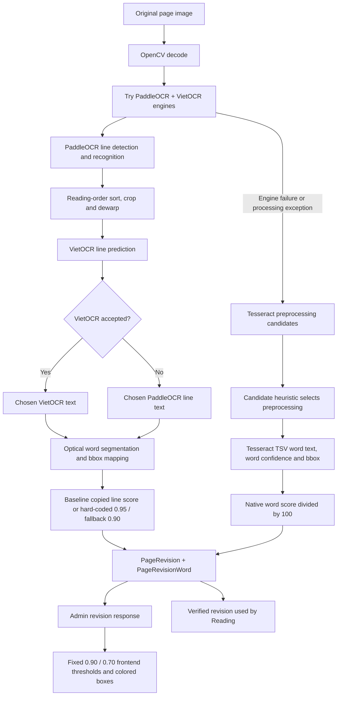
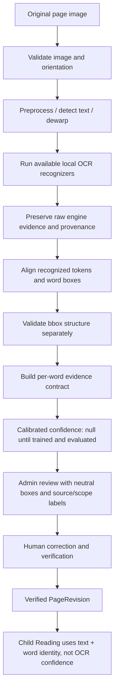

# OCR Confidence Flow and Evaluation

## 1. Purpose

This document explains the actual OCR confidence behavior and the corrected
engineering contract for ViRead. It is written for implementation review and
capstone presentation.

A score produced by an OCR engine is evidence about the engine's own output.
It is not automatically the probability that a Vietnamese word is correct.
A calibrated confidence is a separate statistical estimate that requires
labeled examples and held-out evaluation.

## 2. Actual current flow (baseline on main)

Baseline limitations:

- PaddleOCR output exposes a line recognition score in this integration, not a
  separate measured score for every token created by subsequent segmentation.
- VietOCR prediction returns text only in this integration.
- Tesseract provides a native token-level score, but its normalized scalar is
  not calibrated against ViRead Vietnamese ground truth.
- Candidate selection score is only used to rank image preprocessing variants.
- Frontend thresholds were not empirically calibrated.
- Mean raw word scores were previously exposed as a page confidence.

## 3. Corrected confidence contract on this branch

Status by component:

| Component | Status on this branch |
|---|---|
| Local PaddleOCR + VietOCR recognition | Existing |
| Local Tesseract fallback and preprocessing selection | Existing |
| Genuine Tesseract per-word raw score preservation | Implemented |
| PaddleOCR line score preserved as line-scoped evidence | Implemented |
| VietOCR fabricated fixed score removed | Implemented |
| Unified source/scope and calibration metadata | Implemented |
| Word bounding-box ground-truth quality evaluation | Not implemented; requires labeled boxes |
| Calibrated word probability | Not implemented; requires verified paired dataset |
| Admin confidence display without false thresholds | Implemented |
| Page probability from mean word scores | Removed; page confidence remains null |
| Human Admin verification | Existing and preserved |

## 4. Confidence meanings

### Text detection confidence

A measure of confidence that a region contains text. It does not say that
the region's characters were transcribed correctly. In the current PaddleOCR
integration, detected quadrilaterals are returned with line recognition
results; a separately persisted detection probability is not exposed in the
current application contract.

### Recognition confidence

A native score returned by a recognition engine. It must carry its source,
scope and native range.

- Tesseract: a word-level score in the native 0..100 range is available in
  the TSV/data result.
- PaddleOCR: the score used here belongs to a recognized line.
- VietOCR: the current `predict()` integration returns a string; no genuine
  word-level confidence is available from this call.

### Bounding-box / alignment quality

A separate measure of whether a token's coordinates actually enclose the
printed token. The current normalized bbox validation checks range and shape,
not localization accuracy. A future localization evaluation should compare
predicted boxes with manually labeled word boxes (for example using
intersection-over-union) and report those results separately.

### Calibrated word confidence

A calibrated probability is an estimate of the chance that the OCR token
matches the independently verified ground-truth token under a defined
evaluation distribution.

For example, if a model assigns confidence close to 0.90 to 100 words, then
approximately 90 should match the chosen exact-match definition when measured
on representative, independent data. This is a statistical property of a
validated model and data distribution, not a guarantee for each individual
word.

A raw Tesseract score of 90/100 is not automatically a 90% probability.
A PaddleOCR line score of 0.90 is not automatically a 90% probability for
each word in that line. A VietOCR output with no score must not be assigned a
made-up value.

### Page-level confidence

Page confidence requires its own validated definition and evaluation. It must
not be calculated as the arithmetic mean of raw word scores and described as
a calibrated page probability. The current API therefore returns null for
page confidence.

## 5. Example cases

| Case | Recognition evidence | Correct interpretation |
|---|---|---|
| Correct token, weak scan | OCR reads `mèo` correctly but Tesseract raw score is 42/100 | Correctness is known only from ground truth / human review; raw engine evidence is low, not proof of an error |
| Wrong token, confident engine | OCR reads `mẹo` while page says `mèo`, raw score is 96/100 | Engine is confidently wrong; only exact ground-truth comparison identifies the error |
| No native token score | VietOCR returns text only | Score is unavailable; calibrated confidence is null |
| Text correct, box wrong | OCR reads `mèo` correctly but estimated bbox covers `nhỏ` | Recognition can be correct while localization fails; keep the two evaluations separate |

## 6. Calibration methodology required before showing probabilities

A reproducible calibration dataset should be created from original source images,
the original OCR output and human-verified text/word mapping. The exact-match
label must preserve Vietnamese tone marks, vowel marks and the distinction
between `d` and `đ`, using Unicode NFC normalization without removing
diacritics.

Dataset splitting must happen by book or page, not by randomly splitting
individual words from the same page. That avoids leakage from repeated words,
same typography, same page scan and near-identical image characteristics.

Possible calibration methods include sigmoid/Platt calibration and isotonic
regression, but the method must be selected from validation performance and
data sufficiency. Engine-specific score distributions should be evaluated
separately. Agreement between OCR engines is useful evidence but is not proof
of correctness and should not simply be averaged into a probability.

Required metrics:

- Word Exact Match Accuracy.
- Character Error Rate (CER).
- Word Error Rate (WER).
- Brier Score.
- Expected Calibration Error (ECE).
- Reliability diagram / calibration curve.
- Precision among words above the proposed high-confidence threshold.
- Coverage: the proportion of all words receiving a supported prediction.

No dedicated, versioned Vietnamese calibration dataset or held-out evaluation
artifact was found at the inspected baseline HEAD. Consequently, this branch
does not claim or display calibrated word probabilities and does not invent
metric values. The Admin UI reports raw evidence and unknown/un-calibrated
state instead.

## 6A. Child Reading Vietnamese matching safeguard

The real-time reading alignment path is separate from OCR confidence. On this
branch, it preserves Unicode NFC Vietnamese marks for exact token matching.
The helper that removes combining marks is used only to flag a possible
diacritic-only mismatch as `AMBIGUOUS`; it does not decide that the words are
equal. The character `đ` remains distinct from `d`.

Examples:

- `ma` versus `má`: not an exact match; potentially ambiguous STT evidence.
- `cá` versus `ca`: not an exact match; potentially ambiguous STT evidence.
- `đi` versus `di`: not an exact match; treated as ambiguous STT evidence,
  not proof that the child pronounced the word incorrectly.
- `chú` versus `chú`: exact match.

Ambiguous tokens use a neutral UI style and do not increment the confirmed
mispronunciation set. This is a limited safeguard, not a general STT confidence
model. The current adapter does not expose a trusted, consistently available
word-level confidence input to this aligner. Final transcript comparison
already uses NFC/lowercase normalization without stripping Vietnamese marks.

### Saved ReadingReport compatibility

The server's final comparison retains Unicode Vietnamese marks in its exact
text alignment. Older saved reports may consequently contain
`SUBSTITUTE` for orthographic-only STT differences. The display layer now
separates tone/vowel/d-đ-only pairs into a neutral "insufficient evidence"
count without mutating historical report data; unrelated substitutions remain
wrong-word candidates. Regression tests cover both cases.

## 7. Suggested future evaluation record

Each labeled example should retain at least:

- Stable dataset example ID.
- Book ID / page ID / image hash for group splitting and provenance.
- Original OCR engine and engine version.
- Preprocessing configuration.
- OCR token and exact manually verified token.
- Native score, native range, score source and score scope.
- Word bounding box and, when available, manually labeled ground-truth box.
- Exact-match label.
- Calibration model version and split identifier.

Do not train or evaluate against text that was corrected after the fact unless
the original OCR output is preserved separately. A corrected word's score
belongs to the original recognition result, not automatically to the
administrator's corrected token.

## 8. Presentation explanation

"ViRead first scans a page and recognizes its text with local OCR engines. The
recognition engines provide different kinds of evidence: Tesseract provides
a score for each word, PaddleOCR provides a score for a text line in the
current integration, and VietOCR returns text without a word-level score.
These scores cannot be treated as the same percentage.

We therefore keep the source and level of each score, separate word-box
quality from text recognition, and do not display an estimated probability
until we have enough administrator-verified Vietnamese examples to train and
validate a calibration model. The administrator remains responsible for
verifying the page before the content is used in a child's reading session."

## 9. Main implementation references

- `backend/app/services/ocr_engine.py`
- `backend/app/services/admin_ocr_service.py`
- `backend/app/models/book.py`
- `backend/app/schemas/book.py`
- `backend/app/services/reading_content_service.py`
- `frontend/components/admin/admin-ocr-review-screen.tsx`
- `frontend/lib/api/ocr-review-service.ts`
- `frontend/lib/reading/realtime-alignment.ts`
- `frontend/components/reading/book-page-content.tsx`
