# ARCHITECTURE — Kiến trúc hệ thống Luyện Từ & Đọc Lại Từ Ngắn (ViRead / ReadAlong Vision)

Tài liệu mô tả kiến trúc sau nâng cấp cho hai luồng hợp nhất: **Đọc lại từ ngay trong trang sách** (`/reading/[sessionId]`) và **Luyện từ cần ôn** (`/reports/difficult-words`).

---

## 1. Sơ đồ luồng xử lý tổng thể

```mermaid
flowchart LR
  UI_Read["ReadingScreen (In-Book Retry)\nactiveRetryWordId (Vàng)"] --> Engine
  UI_Practice["DifficultWordPracticePanel\n(1-Tap Hands-Free Loop)"] --> Engine

  subgraph Frontend Core
    Engine["word-practice-engine.ts\nSHORT_WORD_CAPTURE_CONFIG\nshouldAutoStopShortWordCapture()"] --> AQ["AudioQualityMonitor\nmode: 'short-word'\ncalibration 60ms | min 160ms"]
    AQ --> VAD["Acoustic VAD + Browser STT\nhasShortWordSpeechActivity()"]
    VAD --> EvalFE["evaluateRecordedShortWord()\nclassifyPracticePhraseTranscript()"]
  end

  EvalFE -->|"1 HTTP POST /practice/evaluate\n(audio hoặc browser transcript)"| API

  subgraph Backend FastAPI
    API["system.py:\nPOST /system/difficult-words/{child_id}/practice/evaluate\nGET /system/difficult-words/{child_id}"] --> Svc["DifficultWordsService\nREQUIRED_CONSECUTIVE_CORRECT = 1\n_NON_SPEECH_TAG_RE + Echo Collapse"]
    Svc -->|"Storage ready?"| Table["difficult_word_practice_attempts\n(+ bookid, sessionid, pageid, pagerevisionid, wordid)"]
    Svc -->|"Chưa có bảng\n(Zero-503 Fallback)"| Events["readingevents\n(Type = 'WORD_RETRY')"]
  end

  Table --> Merge["_load_merged_attempts()\n+ compute_word_practice_progress()"]
  Events --> Merge
  Events --> Comp["ReadingComparisonService.list_for_session()\n-> self_corrected_word_ids"]
  Comp --> Sync["Red -> Yellow -> Green Sync\nWordHighlightOverlay / ReadingReport / SessionReadingReports"]
```

---

## 2. Thành phần Frontend

| Module | Vai trò chính | Link |
| --- | --- | --- |
| Core Engine | State machine (`WordPracticeState`), `SHORT_WORD_CAPTURE_CONFIG`, VAD auto-stop `shouldAutoStopShortWordCapture`, `hasShortWordSpeechActivity`, `VOICE_PROMPTS`, `evaluateRecordedShortWord` | [word-practice-engine.ts](file:///F:/c1/capstone1/frontend/lib/reading/word-practice-engine.ts) |
| Audio Quality Preset | Phân tách profile `"passage"` vs `"short-word"`, kẹp onset trong cửa sổ calibration 60ms, `hasShortWordBlockingAudioIssue` | [audio-quality.ts](file:///F:/c1/capstone1/frontend/lib/reading/audio-quality.ts) |
| Speech Recorder Hook | Hỗ trợ `SpeechRecorderStartOptions` (`{ retainStream?: boolean; mode?: AudioQualityMode }`) | [use-speech-recorder.ts](file:///F:/c1/capstone1/frontend/hooks/use-speech-recorder.ts) |
| Word Classification | `stripNonSpeechAnnotations`, gộp token echo lặp, `classifyPracticePhraseTranscript` | [retry-word-recognition.ts](file:///F:/c1/capstone1/frontend/lib/reading/retry-word-recognition.ts) |
| In-Book Retry Sync | Đồng bộ đỏ → vàng → xanh tại trang đọc & báo cáo đối chiếu | [reading-screen.tsx](file:///F:/c1/capstone1/frontend/components/reading/reading-screen.tsx), [word-highlight-overlay.tsx](file:///F:/c1/capstone1/frontend/components/reading/word-highlight-overlay.tsx), [ReadingReport.tsx](file:///F:/c1/capstone1/frontend/components/reading/ReadingReport.tsx), [session-reading-reports.tsx](file:///F:/c1/capstone1/frontend/components/reports/session-reading-reports.tsx) |
| Practice API & Grouping | `evaluatePracticeWord` (1-roundtrip), `groupDifficultWordsByBook`, giữ `sources` & provenance | [difficult-word-service.ts](file:///F:/c1/capstone1/frontend/lib/api/difficult-word-service.ts), [reports.ts](file:///F:/c1/capstone1/frontend/types/reports.ts) |
| `/reports/difficult-words` UI | Overview nhóm theo sách, chip từ bấm trực tiếp, `
` phụ huynh, panel luyện 1 chạm rảnh tay | [difficult-words-screen.tsx](file:///F:/c1/capstone1/frontend/components/reports/difficult-words-screen.tsx), [difficult-word-book-card.tsx](file:///F:/c1/capstone1/frontend/components/reports/difficult-word-book-card.tsx), [difficult-word-practice-panel.tsx](file:///F:/c1/capstone1/frontend/components/reports/difficult-word-practice-panel.tsx) |

---

## 3. Thành phần Backend & Hợp đồng API

1. **Routes tại [system.py](file:///F:/c1/capstone1/backend/app/api/routes/system.py)**:
   - `GET /system/difficult-words/{child_id}` — trả `list[DifficultWordRead]` kèm `sources: list[DifficultWordSourceRead]` (sách, lớp, trang, câu ngữ cảnh `_build_context_phrase`) và trạng thái luyện đã hợp nhất giữa 2 kho lưu.
   - `GET /system/difficult-words/{child_id}/practice/history` — trả lịch sử lượt luyện cho phụ huynh từ `_load_merged_attempts`.
   - `POST /system/difficult-words/{child_id}/practice/evaluate` — endpoint 1 roundtrip nhận multipart audio hoặc fallback transcript + ngữ cảnh provenance (`book_id`, `session_id`, `page_id`, `page_revision_id`, `word_id`), đánh giá tức thì và lưu kết quả.
   - Các endpoint cũ (`/practice/start`, `/practice/{attempt_id}/evaluate-audio`, `/practice/{attempt_id}/complete`) tiếp tục được giữ để tương thích ngược, nhưng cũng áp dụng `REQUIRED_CONSECUTIVE_CORRECT = 1` và dual-store fallback (không trả `503` nếu thiếu bảng).

2. **Dual-Store & Quy tắc chống gian lận độ chính xác**:
   - Không hạ chuẩn độ chính xác tiếng Việt: sai phụ âm đầu (`cá` ≠ `chó`), sai thanh điệu (`có` ≠ `cỏ` ≠ `cá`) hoặc nhiễu âm vẫn bị phân loại `INCORRECT` / `UNCERTAIN`.
   - Lượt `UNCERTAIN` hoặc `NO_CLEAR_AUDIO` không bị phạt vào số lần sai hay reset chuỗi đúng, giữ trải nghiệm thân thiện cho trẻ lớp 1.
   - Tất cả endpoint kiểm tra quyền sở hữu `parent_id` → `child_id` và idempotency theo `request_id`.
