# ViRead child reading experience

Delivery documentation for the recovered master prompt, through Phase 7 validation and Phase 8 handoff. Implementation, automated evidence and real-world acceptance are distinct. See [final acceptance](FINAL_ACCEPTANCE.md), [validation](VALIDATION.md), [audio experiment](REAL_AUDIO_REPORT.md) and [delivery status](DELIVERY.md).

## Architecture

```mermaid
flowchart LR
  Capture[User gesture and recorder] --> Quality[Audio quality and transcript evidence]
  Quality --> Align[Vietnamese normalization and ordered word alignment]
  Align --> Initial[First-pass page / revision / word snapshot]
  Initial --> Compare[Owned comparison API and session row lock]
  Compare --> Practice[Sample / listen / evaluate / save / acknowledge]
  Practice --> Retry[Identity-bound retry events]
  Compare --> Reports[Canonical first-pass assessment]
  Retry --> Reports
  Reports --> History[Completion / history / parent / dashboard]
  Upload[Admin source image] --> Revision[Source provenance and reviewable OCR revision]
  Revision --> Verified[Explicit verification]
  Verified --> Viewer[Revision-bound image / overlay / text fallback]
  Viewer --> Capture
  Voice[Verified voice metadata and speed] --> Playback[Cancelable audio and word timing]
  Playback --> Practice
```

The existing frontend services, MediaRecorder/Web Audio pipeline, retry flow, SQLAlchemy repositories and storage/provider boundaries are reused. No new runtime dependency or application migration was added.

## Root causes and resulting behavior

| Problem                                                                            | Resulting behavior                                                                                                         |
| ---------------------------------------------------------------------------------- | -------------------------------------------------------------------------------------------------------------------------- |
| Later reading or a return visit could replace the first completed page's evidence  | A page/revision snapshot freezes its original transcript and word statuses; rereading cannot raise the original score      |
| An uncertain segment discarded valid evidence from the whole page                  | Confirmed matches/errors remain usable; only missing evidence stays uncertain                                              |
| Repetition replaced a canonical match/error                                        | Repetition is tracked separately from first-pass status and retry eligibility                                              |
| Dashboard dropped insertions from finalized reports                                | Added words come from the same stored alignment; target-word assessment stays immutable                                    |
| UI could advance before comparison/retry acknowledgment                            | Final comparison and retry persistence precede progression; identical retries replay without duplication                   |
| Refresh reset retry state                                                          | Practice-state restores persisted identities, counts and terminal states without automatically starting a microphone       |
| Recorder failure released the stream but left the screen listening                 | The hook notifies the current consumer; the screen invalidates stale work, shows recovery and preserves retry counts       |
| Desktop media queries and truncation cut toolbar labels under magnification        | Container-based controls reflow, labels wrap and the reading page can shrink below 320 CSS pixels                          |
| Shared button width expanded the dialog close control and squeezed the voice title | Explicit 48-pixel close dimensions override shared full-width button defaults; focus behavior remains intact               |
| Event metadata could be arbitrarily large or contain non-finite JSON numbers       | New writes reject metadata exceeding 64 KiB of compact UTF-8 JSON or invalid JSON values; legacy responses remain readable |
| Images followed the page's current source rather than the reading revision         | Revision source provenance, dimensions and words stay together; unavailable historical images fall back to text            |
| Timed playback and microphone operations could outlive their page/attempt          | Capture/playback generations, cancellation and identity checks reject stale callbacks                                      |

## Contracts and database impact

- Image overlay eligibility now requires content-bound geometry evidence; see [the box geometry correction](BOX_GEOMETRY_FIX.md). Legacy or edited boxes use the existing image-reference/OCR-text fallback without modifying stored revisions.

- Final comparisons accept `finalize` and an exact `initial_assessment` bound to page/revision/word IDs. Conflicting finalized rewrites or deletion are rejected; exact replay remains safe after completion.
- `GET /reading/sessions/{id}/practice-state` returns owned persisted evidence and retry progress. Deploy frontend and backend together.
- Retry metadata carries attempt, incorrect count and resolution. Uncertain or technical failures do not consume an incorrect attempt. Three confirmed incorrect attempts resolve the word; self-correction remains separate from the original assessment.
- New `ReadingEventCreate.Metadata` writes have a 65,536-byte compact UTF-8 JSON limit and reject NaN/Infinity. Existing stored metadata is neither rewritten nor rejected merely for being larger when returned in a response.
- Admin upload/replacement accepts an operation identity. Replays reuse the operation; replacement produces a revision requiring review. Image preview can select the exact revision.
- Existing JSON columns hold snapshots and source provenance. No destructive migration, history rewrite or cleanup of referenced historical objects was introduced.
- Session finalization, retry and progress writes lock the same session row. Real disposable PostgreSQL tests cover concurrent writes and stale ORM identity maps.

## Main implementation locations

- Reading orchestration: `frontend/components/reading/reading-screen.tsx` and `frontend/lib/reading/`.
- Recording/playback: `frontend/hooks/use-speech-recorder.ts`, `use-speech-player.ts`, API speech/voice services.
- Presentation: reading layout/controls/viewer, voice settings and shared assessment summaries.
- Backend: reading content/comparison services and repositories, `reading_assessment.py`, child-progress metrics and reading schemas/routes.
- Admin images: OCR service/repository, image preview and book/revision screens.
- Regression coverage: frontend reading tests/browser tests and backend reading, voice, image and PostgreSQL tests.

## Practical limits

Completed-page snapshots remain in memory until the existing save boundary; this work does not add autosave on every page turn or recover unsaved audio after closing the tab. PostgreSQL fixtures demonstrate transaction behavior in disposable schemas, not production schema parity or capacity. Auth identity and voice/storage boundaries are synthetic where identified in the validation report. Live provider/storage policies, physical device calibration and speech accuracy need separate acceptance evidence.
