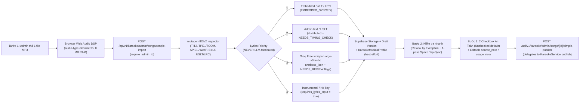

# Admin Karaoke One-File Simple Mode Automation (G08 P0 — ViRead Play & Learn V4.0)

- **Date:** 2026-11-25
- **Branch:** `feature/viread-intelligent-play-learn-v4`
- **Cost & Hosting Profile:** **0 VND / 0 USD**, Render Free **512 MiB RAM** safe (zero `ffmpeg`, zero PyTorch/Demucs in web container; audio DSP runs 100% client-side in the Admin's browser).

---

## 1. Architecture Overview

Admin Karaoke Simple Mode replaces the high-friction legacy 4-card manual workflow (which was the active default whenever offline Demucs/CTC worker flags were OFF) with an effortless **1-MP3 upload → Review by Exception → Explicit Safety Confirm & Publish** pipeline, while preserving 100% backward compatibility with the Advanced Editor (`KaraokeEditorScreen`), existing Wizard Mode (`KaraokeWizardScreen`), and all publication/revision/Storage security invariants.

---

## 2. Backend Components & Contracts

### 2.1 Rich MP3/ID3v2 & LRC Extraction (`backend/app/services/karaoke_media_service.py`)
Preserves all existing functions (`AudioMetadata`, `read_upload`, `inspect_audio`, `normalize_cover`) unchanged and adds:

- **`extract_mp3_metadata(data: bytes, filename: str = "") -> dict`**:
  - Validates MP3 bytes through existing `inspect_audio()` (enforcing `<= 20 MiB`, valid MPEG Layer III, `1..300,000 ms`, SHA-256).
  - Extracts `TIT2` (title, falling back to cleaned filename via `clean_filename_title()` stripping track prefixes like `01_` / `02 -` and noise tags like `[320kbps]`, `(Official Audio)`).
  - Extracts `TPE1` (artist) with `TCOM` (composer) fallback.
  - Extracts embedded `APIC` cover art, passing raw bytes safely through existing `normalize_cover()` (decompression-bomb guard, `<= 4096 px`, non-animated JPEG/PNG/WebP, EXIF stripping, WebP output `<= 2 MiB`). Corrupt or oversized `APIC` frames are safely skipped without failing MP3 import.
  - Extracts `USLT` unsynced lyrics and `SYLT` synced lyrics (or inline `[mm:ss.xx]` LRC timestamps inside `USLT`) into valid ViRead `lyrics` JSON (`{"format_version": 1, "lines": [...]}`).
- **`parse_lrc_text(lrc: str, duration_ms: int, *, include_syllables: bool = True) -> dict`**:
  - Parses `[mm:ss.xx]`, `[mm:ss.xxx]`, multi-timestamp lines, and `[offset:+/-ms]` headers while stripping metadata tags (`[ti:...]`, `[ar:...]`, etc.).
  - Produces strictly non-overlapping, schema-validated `format_version: 2` syllable-timed ViRead `lyrics` (falling back cleanly to `format_version: 1` if audio duration cannot fit 1 ms per syllable) along with honest `confidence` metadata (`line_starts: "EXACT_LRC"`, `line_ends: "NEXT_LINE_OR_DURATION_ESTIMATE"`, `syllables: "PROPORTIONAL_ESTIMATE"`).

### 2.2 One-File Auto-Import & Compliant Publish (`backend/app/api/routes/karaoke_simple_import.py`, `backend/app/services/karaoke_simple_import_service.py`, `backend/app/schemas/karaoke_simple_import.py`)
Router (`router = APIRouter()`) is mounted under `/karaoke` (full prefix `/api/v1/karaoke`):

1. **`POST /admin/songs/simple-import`** (`201 Created`, protected by `require_admin_id`):
   - Accepts multipart form: required `audio` MP3 file plus optional `title`, `author`, `min_grade`, `max_grade`, `lyrics_text`, `audio_type`, `bpm`, `auto_transcribe` (default `True`), `source_note`, `usage_note`, `rights_confirmed` (default `False`), `child_safe_confirmed` (default `False`).
   - **Strict Lyrics Priority (NEVER fabricates lyrics via LLM):**
     1. Embedded `SYLT` or LRC timestamps in `USLT` → `lyrics_source = "EMBEDDED_SYNCED"` (zero flags).
     2. Admin-provided `lyrics_text` (parsed as LRC if timestamped, otherwise evenly distributed with `NEEDS_TIMING_CHECK` flags) or embedded plain `USLT` → `lyrics_source = "ADMIN_TEXT"` or `"EMBEDDED_UNSYNCED"`.
     3. Optional zero-cost **Groq Free `whisper-large-v3-turbo`** (`https://api.groq.com/openai/v1/audio/transcriptions`, `response_format=verbose_json`, `timestamp_granularities[]=segment,word`, `language=vi`) — **ONLY** when `GROQ_API_KEY` is configured, `auto_transcribe=True`, and `audio_type != "INSTRUMENTAL_ONLY"`. Maps real timestamps into ViRead `lyrics` and explicitly flags segments with `avg_logprob < -0.5` or `no_speech_prob > 0.5` as `NEEDS_REVIEW`.
     4. If `INSTRUMENTAL_ONLY`, transcription disabled, or no lyrics/key available → creates valid draft cleanly with `lyrics_source = "NONE"` and `requires_lyrics_input = True` (zero dead-end error).
   - Persists real `KaraokeSong` + `KaraokeSongVersion` (`DRAFT`) using existing `KaraokeRepository` and `KaraokeStorage` paths (`songs/{song_id}/versions/{version_id}/audio/{uuid}.mp3` and optional `covers/{uuid}.webp`), preserving SHA-256 timing binding (`timed_audio_sha256`), short transactions (Storage I/O always outside DB locks), and orphan cleanup.
   - Saves compact profile (`bpm`, `audio_type`, `source_method`, `profile_json`) into `KaraokeMusicalProfile` in an isolated best-effort transaction (gracefully skipped if table is not migrated yet).
2. **`POST /admin/songs/{song_id}/simple-publish`** (`200 OK`, protected by `require_admin_id`):
   - Enforces explicit unchecked-by-default compliance: rejects with HTTP `422` unless `rights_confirmed == True` AND `child_safe_confirmed == True` AND non-empty `source_note` & `usage_note`.
   - Applies inline edits (metadata, notes, reviewed/tap-synced lyrics) via `KaraokeService.save()` and delegates final publication to `KaraokeService.publish()`, preserving `content_issues()`, `_publication_issues()`, `_media_available()`, and optimistic `expected_revision` locking.

---

## 3. Frontend Components & Client DSP

### 3.1 Browser Web Audio Classifier (`frontend/lib/karaoke/audio-type-classifier.ts`)
- Pure TypeScript DSP running in the Admin's browser (`0 MB` server RAM, zero external dependencies).
- Decodes audio via `AudioContext.decodeAudioData()` (closing the context in `finally`), samples up to 24 seconds centered in the song, and computes:
  - **Mid/Side stereo vocal energy ratio** (`300–3400 Hz` energy in `(L+R)/2` vs `(L-R)/2`).
  - **Vocal-band spectral energy ratio** (`300–3400 Hz` / `50–8000 Hz` via inline 1024-point Hann-windowed radix-2 FFT).
  - **Syllabic dynamic modulation (`2–8 Hz`)** and **voiced pitch periodicity (`140–700 Hz`)**.
  - **Onset-flux BPM estimation (`60–180 BPM`)** with 3-tap smoothing, mild children's-song tempo prior (resolving 60/120 BPM octave ambiguity), and parabolic peak interpolation.
- Returns `{ audioType: 'VOCAL_FULL' | 'INSTRUMENTAL_ONLY' | 'UNKNOWN', estimatedBpm, confidence, guidanceVi, metrics }`.

### 3.2 Simple Mode UI & Workspace Integration
- **`frontend/lib/api/karaoke-simple-import-service.ts`**: Strict Zod-validated client for `/karaoke/admin/songs/simple-import` and `/karaoke/admin/songs/{songId}/simple-publish`.
- **`frontend/components/admin/karaoke/karaoke-simple-upload-screen.tsx`**:
  - **Bước 1 — Chọn 1 file MP3**: Drag-drop/pick MP3, instant browser vocal/instrumental badge + filename title suggestion, optional collapsed quick-fill for `.lrc`/lyrics/grade, 1-click **"Tự động tạo karaoke"**.
  - **Bước 2 — Kiểm tra nhanh (Review by Exception)**: Audio playback preview, detected metadata & cover art badge, highlights **only** flagged lines (`NEEDS_REVIEW` / `NEEDS_TIMING_CHECK`) with inline text edit & seek-to-play, 1-step inline lyrics box for instrumental tracks, and inline **1-pass Spacebar Tap-to-Sync** mini-mode.
  - **Bước 3 — Xác nhận an toàn & Xuất bản**: Visible pre-filled editable `source_note` & `usage_note` (never hidden in `
`), two explicit **unchecked-by-default** compliance checkboxes (`rights_confirmed` & `child_safe_confirmed`), **"Xuất bản ngay"** (disabled until both checked + valid timed lyrics), and 1-click **"Chỉnh sửa nâng cao"**.
- **`frontend/components/admin/karaoke/karaoke-workspace-screen.tsx`**:
  - Makes **Simple Mode** the default on `/admin/karaoke/new` whenever the current backend is reachable (even when offline Demucs worker `capabilities.enabled` is `false`!), while preserving old-backend 404 fallback, 401/403 error alerts, published-song draft gate, existing Wizard Mode for existing processing jobs, and 1-click **"Chỉnh sửa nâng cao"** toggle to `KaraokeEditorScreen`.
- **`frontend/components/admin/karaoke/syllable-timing-editor.tsx`**:
  - Fixed idle 60fps paused `requestAnimationFrame` loop (`L67–76`): rAF now schedules **only** when `player?.playing` is true, cancelling immediately on pause and syncing `setTime()` cleanly on mount/mark.

---

## 4. Security & Safety Invariants Preserved

- **Admin RBAC**: Both endpoints require active database admin via `require_admin_id` plus repository role verification (`403` for parents/inactive accounts).
- **Zero Lyric Hallucination**: Never invokes an LLM to invent song lyrics; Groove/Groq Whisper is strictly acoustic speech-to-text with low-confidence review flags, and instrumental tracks never call Whisper.
- **No Compliance Bypass**: Both checkboxes default to `false` on client and server; `simple_publish` refuses `422` unless both confirmations and non-empty `source_note`/`usage_note` are present, and delegates final checks to `KaraokeService.publish()`.
- **No Secret Leakage**: `GROQ_API_KEY` stays strictly server-side and is never logged or echoed to responses.
