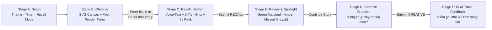

# AI Memory & Creative Story Game — “Bé nhớ được gì?” (G09 Design)

## 1. Overview & Pedagogical Goals

**“Bé nhớ được gì?”** is a zero-cost, Vietnamese primary-school (Grades 1–5) visual working-memory, observation, vocabulary, and creative storytelling game in **ViRead Intelligent Play & Learn V4.0**.

### Core Design Principles

1. **0 VND, 0 Storage Bytes, 100% Verifiable Ground Truth**:
   - Instead of calling paid image-generation APIs (which cost money, add latency, require object storage, and hallucinate unverified objects), every scene is composed deterministically as a parametric `SceneSpec` on the backend (`backend/app/services/games/memory_scene_generator.py`) and rendered as crisp accessible SVG on the client (`frontend/components/entertainment/memory-game/memory-scene-canvas.tsx`).
   - Every sprite, color, quantity (`1..3`), spatial zone, and normalized bounding box `[x, y, w, h]` is known with 100% certainty before the child ever sees the picture — eliminating evaluator hallucination.
2. **Working-Memory Grade Scaling**:
   - Object counts respect primary-school visual working-memory limits:
     - **Grade 1**: `3–4` objects (recommended `60S`, `GUIDED_RECALL`)
     - **Grades 2–3**: `5–6` objects (recommended `30S`, `GUIDED_RECALL` / `FREE_RECALL`)
     - **Grades 4–5**: `7–9` objects (recommended `20S`, `FREE_RECALL`)
3. **Strict Separation of Factual Memory vs. Creative Imagination**:
   - **Điểm ghi nhớ (`factual_score`, 0–100)** evaluates accurate recall of real scene details (objects, Vietnamese synonyms, colors, counts, spatial zones).
   - **Điểm sáng tạo (`creative_score`, 0–100)** evaluates how warmly and imaginatively the child continues the story (`"Chuyện gì xảy ra tiếp theo trong bức tranh?"`).
   - Imaginative additions in Stage `CREATIVE` (or explicitly framed with phrases such as *“chắc là”*, *“sắp tới”*, *“tưởng tượng”*, *“biến thành”*) are **never** penalized as factual errors.
4. **Supportive, Non-Shaming Scaffolding**:
   - **3-tier progressive hints** (Tier 1 category → Tier 2 location + color + count → Tier 3 initial word clue) target objects the child has not mentioned yet.
   - **Supported Peek** opens the picture for a gentle 3-second refresh, transparently logging `peek_count` with affirming coaching rather than harsh penalties.
   - **Post-Render Calm Timer**: Selectable `10S`, `20S`, `30S`, `60S`, `90S`, `120S`, or `UNLIMITED`. Countdown starts **strictly after** the SVG commits and fires `sceneReady === true`, using a calm circular progress indicator (never aggressive red flashing) plus a 1-click **“Bé đã nhớ xong”** skip button.
5. **Reading Ecosystem Integration (`focus_words`)**:
   - When creating a session, the backend automatically reads the child's recent difficult reading words (or accepts explicit `focus_words`) and prioritizes matching Vietnamese sprites so reading vocabulary is reinforced naturally through visual memory play.

---

## 2. Deterministic Parametric SVG Scene Composer

### 2.1 Six Vietnamese Child-Friendly Themes & 42 Distinct Sprites

Every theme includes **7 dedicated kid-friendly vector sprites** (**42 distinct sprites total**, exceeding the 36+ requirement), with cross-theme guest sprites used only when Grade 4–5 scenes require 8–9 distinct items without duplication.

| # | `theme_key` | Vietnamese Name | Dedicated Vector Sprites (7 per theme) |
|---|---|---|---|
| 1 | `sunny_garden` | Khu vườn nắng mai | `tabby_cat` (mèo mướp), `butterfly` (bướm xinh), `sunflower` (hoa hướng dương), `watering_can` (bình tưới cây), `paper_kite` (diều giấy), `singing_bird` (chim sẻ), `garden_ball` (quả bóng) |
| 2 | `happy_classroom` | Lớp học vui vẻ | `open_book` (quyển sách), `pencil_cup` (bút chì), `school_bag` (cặp sách), `world_globe` (quả địa cầu), `wall_clock` (đồng hồ), `paper_plane` (máy bay giấy), `teddy_bear` (gấu bông) |
| 3 | `mid_autumn_yard` | Sân đình Trung thu | `star_lantern` (đèn ông sao), `rice_drum` (trống cơm), `mooncake_plate` (bánh trung thu), `jade_rabbit` (thỏ ngọc), `lion_mask` (đầu lân), `carp_lantern` (đèn cá chép), `pomelo_fruit` (quả bưởi) |
| 4 | `seaside_morning` | Biển sớm quê em | `sailboat` (thuyền buồm), `seashell` (vỏ sò), `starfish` (sao biển), `sandcastle` (lâu đài cát), `seagull` (chim hải âu), `swim_ring` (phao bơi), `beach_umbrella` (chiếc ô biển) |
| 5 | `countryside_pond` | Ao sen làng quê | `lotus_flower` (hoa sen), `green_frog` (chú ếch), `dragonfly` (chuồn chuồn), `yellow_duck` (vịt con), `carp_fish` (cá chép), `conical_hat` (nón lá), `bamboo_boat` (thuyền nan) |
| 6 | `friendly_market` | Góc chợ tuổi thơ | `watermelon` (dưa hấu), `banana_bunch` (nải chuối), `woven_basket` (giỏ mây), `clay_piggy` (heo đất), `pinwheel` (chong chóng), `banh_chung` (bánh chưng), `mango_fruit` (quả xoài) |

### 2.2 Six High-Contrast Canonical Colors + Colorblind Shape Cues

| `color_vi` | Fill Hex | Stroke Hex | Light Hex | Shape Cue |
|---|---|---|---|---|
| `đỏ` | `#D63031` | `#8E1B1B` | `#FF8A8A` | `circle` |
| `xanh dương` | `#1D63D8` | `#0F3C8A` | `#7CB4FF` | `square` |
| `vàng` | `#E09F00` | `#8C5E00` | `#FFE074` | `star` |
| `xanh lá` | `#1F8A4C` | `#11522C` | `#73DC9D` | `triangle` |
| `cam` | `#E56B1F` | `#993E08` | `#FFAF75` | `diamond` |
| `tím` | `#7B3FE4` | `#4B1E99` | `#C4A5FF` | `hexagon` |

### 2.3 Collision-Free Layout & Determinism

- **Seed Derivation**: `SHA-256("v4|{theme_key}|{grade}|{difficulty}|{scene_seed}|{focus_words}")` initializes a local `random.Random` instance. Identical inputs produce byte-for-byte identical `SceneSpec` output across processes and platforms.
- **Disjoint 3×3 Grid (`LAYOUT_SLOTS`)**:
  - 9 base slots (`w = 0.24`, `h = 0.22`) at `x ∈ {0.05, 0.38, 0.71}` and `y ∈ {0.08, 0.39, 0.70}` mapped to canonical Vietnamese spatial zones (`trên trái`, `trên phải`, `giữa`, `dưới trái`, `dưới phải`) and natural depth layers (`sky`, `mid`, `ground`).
  - Bounded micro-jitter (`|dx| ≤ 0.009`, `|dy| ≤ 0.008`) keeps scenes organic while mathematically guaranteeing ≥ 0.04 normalized separation between every pair of bounding boxes (`0%` overlap across all themes, grades 1–5, difficulties 1–5, and all seeds).

---

## 3. Six-Stage Gameplay Loop & Anti-TTS-Self-Capture Voice Lifecycle

### Voice & Anti-Self-Capture Guard (Matching G10)

- Starting TTS (`Nghe hướng dẫn` / `Nghe câu hỏi`) **immediately aborts** any active `SpeechRecognition` session before audio plays.
- Starting microphone capture (`Nói bằng giọng nói` / `Kể bằng giọng nói`) **immediately cancels** active TTS (`speechPlayer.stop()` + `window.speechSynthesis.cancel()`) and enforces a `350ms` acoustic echo cooldown if TTS was actively speaking, preventing AI voice playback from being transcribed as the child's answer.
- Tab backgrounding (`visibilitychange`), Android WebView background (`viread:android-background`), and unmount cleanly tear down both microphone recognition and TTS playback.
- Transient network/submit errors preserve the child's typed or spoken draft in state and guard against duplicate concurrent submissions.

---

## 4. Dual-Track Evaluator & Sequential Free-Tier AI Enrichment

Implemented in `backend/app/services/games/memory_game_evaluator.py`:

1. **Deterministic Ground-Truth Matcher (`RECALL`)**:
   - Normalizes Vietnamese both with diacritics (exact precision) and folded (`đ → d`, NFD strip) for unaccented typing / speech-to-text resilience.
   - Matches canonical `name_vi` + curated `aliases_vi` (synonyms so children aren't marked wrong for saying *“con mèo”* instead of *“mèo mướp”* or *“lồng đèn”* for *“đèn ông sao”*).
   - Scores up to `72 pts` for object coverage plus up to `28 pts` for accurate attributes (`color`: 14, `count`: 7, `position`: 7), guaranteeing zero hallucinated facts (`matched_facts ∪ missed_facts === scene_spec.objects`).
2. **Positive Creative Story Rubric (`CREATIVE`)**:
   - Evaluates 4 positive dimensions (`0–25 pts` each, total `0–100`):
     - Scene Anchoring (tying back to scene objects/theme)
     - Narrative Progression & Action connectors (*sau đó, rồi, tiếp theo, cùng nhau...*)
     - Imagination, Dialogue & Emotion (*tưởng tượng, bỗng nhiên, phép màu, vui vẻ...*)
     - Expressive Richness scaled by `child_grade`
   - Preserves `prior_best_factual_score` and returns `missed_facts = []` so creative inventions are never flagged as factual mistakes.
3. **Optional Sequential Free-Tier Coaching Enrichment**:
   - Strict sequential order: **Gemini Free Tier** (`x-goog-api-key` header only, zero hedged parallel duplicate calls) → **Groq Free Tier** → **Deterministic Vietnamese fallback (`deterministic-v4`)**.
   - **Hard Safety Invariant**: AI enrichment ONLY refines warm Vietnamese text strings (`praise_message_vi`, `story_praise_vi`, `next_tip_vi`, `creative_followup_vi`) and can **never** mutate `matched_facts`, `missed_facts`, `factual_score`, `creative_score`, or `stars`.

---

## 5. Backend API, Persistence & Security

Router exposed at `backend/app/api/routes/memory_game.py` (mounted under `/games/memory`):

| Method & Path | Auth & Ownership | Description |
|---|---|---|
| `GET /games/memory/themes` | `require_parent_id` | Lists 6 themes, 7 timer options (`10S`..`120S`, `UNLIMITED`), 5 grade recommendations, and total sprite count (`42`). |
| `POST /games/memory/sessions` | `require_parent_id` + `ChildProfile.ParentId == parent_id` | Generates deterministic `SceneSpec` (with optional `focus_words`), persists `MemoryGameSession`, returns `201`. |
| `GET /games/memory/sessions?child_id=<uuid>&limit=10` | `require_parent_id` + child ownership | Lists recent memory game sessions for the owned child. |
| `GET /games/memory/sessions/{session_id}` | `require_parent_id` + session ownership | Loads full session details, `SceneSpec`, and attempts. |
| `POST /games/memory/sessions/{session_id}/hint` | `require_parent_id` + session ownership | Returns next progressive hint tier (`1..3`) for an unmentioned object and increments `hints_used`. |
| `POST /games/memory/sessions/{session_id}/peek` | `require_parent_id` + session ownership | Records a 3-second supported peek and returns incremented `peek_count`. |
| `POST /games/memory/sessions/{session_id}/attempts` | `require_parent_id` + session ownership | Evaluates `RECALL` or `CREATIVE` attempt, updates best dual scores & stars, records `LearningSkillEvidence`, and returns exact `bbox` spotlights. |

### Database Persistence & Learning Skill Evidence

- Uses `MemoryGameSession`, `MemoryGameAttempt`, and `LearningSkillEvidence` from `app.models.entertainment_v4`.
- Emits structured skill evidence (`SourceModule = 'MEMORY_GAME'`) for:
  - `visual_memory_recall`
  - `visual_observation`
  - `vocabulary_naming`
  - `story_creativity`
- Probes table readiness safely via nested savepoint (`to_regclass`) so unmigrated environments degrade gracefully without failing user gameplay.

---

## 6. Verification Suite

- **Backend (`backend/test_memory_game.py`)**:
  - Catalog completeness (6 themes, 42 unique sprites, 6 canonical colors, 7 timer modes).
  - Deterministic seed reproducibility & seed variation.
  - Exhaustive collision-free bbox checks + grade object-count caps across all 6 themes × Grades 1–5 × difficulties 1/3/5 × multiple seeds.
  - `focus_words` difficult-word integration.
  - Factual recall matching (synonyms, colors, counts, spatial zones, zero hallucination).
  - Creative imagination non-penalty invariant in both `RECALL` and `CREATIVE` stages.
  - Strict sequential Gemini → Groq fallback preserving deterministic ground truth.
  - End-to-end API lifecycle, evidence logging, unauthenticated `401`, and cross-parent IDOR blocking (`404`).
- **Frontend (`frontend/test/memory-game-ui.test.tsx`)**:
  - `MemorySceneCanvas` SVG rendering and post-render `onSceneReady`.
  - Timer strictly gated on `sceneReady === true` (never ticks before frame commit).
  - `UNLIMITED` timer behavior (no auto-hide) + `"Bé đã nhớ xong"` transition.
  - Full 6-stage flow: setup → observe → hide → progressive hint → recall submit → interactive reveal spotlight (`[x,y,w,h]` mask) → creative story → separate `Điểm ghi nhớ` and `Điểm sáng tạo` cards.
  - Anti-TTS-self-capture guard between `SpeechRecognition` and `speechSynthesis`.
