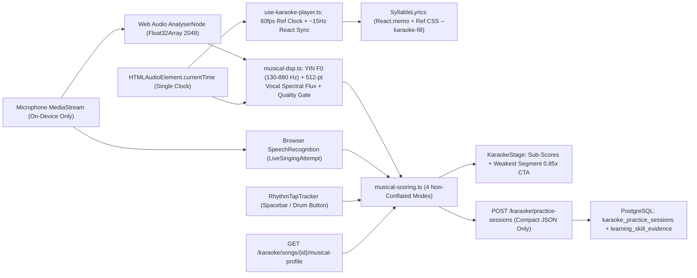

# ViRead Play & Learn V4.0 — Musical Karaoke DSP, 60fps UI & Segment Practice Architecture (G07)

**Date:** 2026-11-25  
**Scope:** Real client-side Web Audio DSP scoring (`YIN F0`, spectral-flux onset, acoustic quality & speaker-bleed gate), honest non-conflated musical scoring, 4 child-friendly practice modes, 60fps UI performance optimization, and compact zero-audio backend persistence.  
**Cost & Privacy Invariant:** **0 VND / zero paid cloud audio APIs**; **zero raw child audio is ever recorded, uploaded, or stored**.

---

## 1. End-to-End Architecture

---

## 2. Client-Side Web Audio DSP Core (`frontend/lib/karaoke/musical-dsp.ts`)

### 2.1 Zero-Allocation Real-Time Pipeline
- **`YinWorkspace`** pre-allocates all scratch buffers (`diff`, `cmnd`, `hp1`, `hp2`, `vocalBand`, `fftRe`, `fftIm`, Hann window, radix-2 bit-reversal & sin/cos tables) once per singing session.
- **`createBrowserMusicalMonitor`** reuses a single `Float32Array(2048)` passed to `AnalyserNode.getFloatTimeDomainData`, polls at `40 ms` (`25 Hz`), throttles HUD telemetry to `100 ms` (`~10 Hz`), and guarantees complete teardown (`clearInterval`, node `disconnect`, `AudioContext.close`) on `stop()`, `pause()`, unmount, `visibilitychange`, and `viread:android-background`.

### 2.2 YIN Fundamental Frequency (`F0`) Detector
1. **DC removal & 4th-order 115 Hz Butterworth high-pass filter** (`2x` cascaded 2nd-order biquads): attenuates `50/60 Hz` electrical hum by ~23 dB while passing child fundamentals (`130–880 Hz`) intact.
2. **Band-energy decomposition**: computes `lowBandRatio (<115 Hz)`, `vocalBandRms (115–3500 Hz)`, and `highBandRatio (>3500 Hz)` to flag electrical hum (`lowBandRatio >= 0.65`) before lag search.
3. **Difference Function & CMND**: searches child vocal lag range `[130 Hz, 880 Hz]` (with a 6% boundary margin so `130 Hz` and `880 Hz` always have interior neighbors for parabolic interpolation).
4. **Parabolic interpolation & voiced gating**: refines lag sub-sample precision to `< 5 cents` on harmonic vocals and requires `clarity = 1 - cmndMin >= 0.72` and `vocalBandRms >= 0.005` for `voiced = true`.
5. **Octave-invariant pitch helpers**: `octaveInvariantSemitoneError(sungHz, refHz)` wraps semitone differences into `[-6, +6]`, ensuring primary-school children singing +1 octave above an adult reference (`C5–G5` vs `C4–G4`) suffer zero octave penalty.

### 2.3 Onset Detection & Acoustic Quality Gate
- **Half-wave rectified 512-pt vocal-band spectral flux** (`130–3500 Hz`) combined with positive log vocal-RMS energy rise and voiced-entry / pitch-step detection against an adaptive 16-frame ring buffer (`115 ms` refractory period).
- **Strict media-clock alignment**: every frame and onset is stamped with `audio.currentTime * 1000` (never wall-clock elapsed time).
- **Acoustic Quality Gate (`DspQualityGate`)**: explicitly distinguishes:
  - `SILENCE` (`silentRatio >= 0.85` or `peakVocalRms < 0.005`)
  - `ELECTRICAL_HUM` (`humRatio >= 0.50` without voiced coverage)
  - `NOISE_ONLY` (`noiseRatio >= 0.60`, high spectral flatness / low periodicity)
  - `SPEAKER_BLEED` (speaker mode `!headphoneMode`: constant low-modulation backing energy across both lyric spans and instrumental gaps with `lyricToGapRatio < 1.38` and low RMS CV `< 0.30`)
  - `LOW_COVERAGE` (`activeVocalCoverageRatio < 0.15`)

---

## 3. Honest Non-Conflated Musical Scoring (`frontend/lib/karaoke/musical-scoring.ts`)

The engine NEVER conflates unavailable modalities or fabricates a pitch score when vocal pitch was not reliably measured:

| Scoring Mode | Trigger Condition | Weights (`Rhythm / Pitch / Lyrics / Fluency`) | Non-Conflation Guarantee |
|---|---|---|---|
| `FULL_MUSICAL` | Quality gate passed + reliable voiced pitch (`>= 5` voiced lyric frames, `>= 16%` voiced lyric coverage) | `40% / 30% / 20% / 10%` (or `50% / 37.5% / 0% / 12.5%` if ASR unavailable) | Uses `REFERENCE_MELODY` when contour exists, else explicitly labels `VOCAL_STEADINESS_AND_CONTOUR` with hard monotone guard |
| `RHYTHM_AND_LYRICS` | Quality gate passed (or `RHYTHM_TAP`) without reliable pitch | `60% / 0% / 30% / 10%` (or `85% / 0% / 0% / 15%` in `RHYTHM_TAP`) | `pitchScore = null` |
| `LYRICS_ONLY` | Web Audio DSP unavailable, browser ASR words evaluated | `0% / 0% / 100% / 0%` | `pitchScore = null`, `rhythmScore = null`, labeled `"Chỉ chấm lời hát"` |
| `INSUFFICIENT_EVIDENCE` | Silence, room noise, 50/60 Hz hum, speaker bleed, or `< 15%` vocal coverage | N/A | `overallScore = null`, all sub-scores `null`, `stars = 0`, warm Vietnamese guidance |

### Key Anti-Gaming Defenses
1. **Minimum-cost order-preserving DP onset alignment** (`maxWindowMs = 450`, `gapPenalty = 680`): prevents beat-skip aliasing so `+350 ms` delayed or `-300 ms` rushed singing cannot falsely align onto neighboring syllables.
2. **Flat monotone spoken reading guard**:
   - With reference contour: large cents deviation + low melodic contour correlation + monotone spread penalty (`sungSpread < 0.45` when `refSpread >= 1.2`).
   - Without reference contour: rewards sustained voiced vowel continuity (`>= 120 ms` runs), low intra-note jitter, and melodic spread, capping flat monotone drones at `<= 35`.
3. **Full-song completion scaling**: singing only 30% of lines in `FULL_SONG` mode scales overall score proportionally (`0.45 + 0.55 * (lineCompletionRatio / 0.85)`) while flagging every missed line as `PRACTICE` in the timestamped segment report and surfacing `weakestSegment` for 1-click `0.85x` practice.

---

## 4. 60fps UI Performance & 4 Practice Modes

### 4.1 Eliminating the 60fps Full-Tree Re-Render Bottleneck
- **`KaraokePlayerScreen`** mounts `ChildKaraokeSession` directly with a stable `source` reference instead of passing freshly cloned `source={{ ...source, lyrics }}` objects on every frame.
- **`useKaraokePlayer`** separates high-frequency clock consumers from React state:
  - `subscribeClock(listener)` runs at full 60fps inside `requestAnimationFrame`, updating `--karaoke-fill` CSS custom properties and `data-state` directly on `SyllableLyrics` DOM refs and updating the playhead progress bar ref with **zero React re-renders**.
  - Continuous rAF React state commits (`setCurrentMs`) are throttled to `~15 Hz` (`65 ms`), while discrete events (`timeupdate`, `seek`, `pause`, `ended`) still commit synchronously.
- **`SyllableLyrics`**, `SyllableUnit`, `LyricPickerList`, and `MusicalSummaryPanel` are wrapped in `React.memo` with memoized `Map` lookups (`useMemo`).

### 4.2 Four Child-Friendly Practice Modes (`musical-practice.ts`)
1. **`FULL_SONG` (Hát cả bài)**: full-song scoring; ONLY mode eligible to update `bestFullSongScore`.
2. **`SEGMENT` (Luyện đoạn khó)**: 1-click `"Luyện lại đoạn này (0.85x)"` loops `[startMs, endMs]` at `0.85x` (preserving pitch via `audio.preservesPitch = true`) and **never overwrites `bestFullSongScore`**.
3. **`LINE_PRACTICE` (Tập từng câu)**: focused single-line rehearsal with optional loop; never overwrites `bestFullSongScore`.
4. **`RHYTHM_TAP` (Gõ nhịp theo bài hát)**: tap big drum button or `Spacebar` on beats with live streak feedback (`Đúng phách tuyệt vời!`), working completely without microphone permission.

### 4.3 Singing With Backing Music
- Displays a friendly headphone recommendation banner (`Khuyên dùng tai nghe...`).
- Supports both **Headphone Mode** (raw acoustic DSP without telephony suppression) and **Speaker Mode With Backing Music** (`Bật nhạc đệm qua loa (lọc nhiễu)` using the leakage-aware acoustic gate instead of hard-blocking backing audio).

---

## 5. Compact Backend Persistence (`karaoke_practice*.py`)

Follows `Router → Schema → Service → Repository → ORM → PostgreSQL`:
- **`POST /karaoke/practice-sessions`** (`require_parent_id`):
  - Verifies `ChildProfile.ParentId == parent_id` (IDOR protection).
  - Strictly forbids raw audio (`extra="forbid"`, recursive blocklist on `report_payload`, 32 KiB max JSON size) and validates scoring-mode invariants.
  - Persists `KaraokePracticeSession` and writes `LearningSkillEvidence` rows for `rhythm_timing`, `pitch_melody`, and `lyric_delivery` **only when `scoring_mode != 'INSUFFICIENT_EVIDENCE'`**.
  - Gracefully degrades (`persisted: false`) if V4 tables have not been migrated yet.
- **`GET /karaoke/practice-sessions?child_id=<uuid>&song_id=<uuid>&limit=10`** (`require_parent_id`):
  - Ownership-verified history + `best_full_song_score` strictly computed over `PracticeMode == 'FULL_SONG'` (excluding `SEGMENT`, `LINE_PRACTICE`, `RHYTHM_TAP`, and `INSUFFICIENT_EVIDENCE`).
- **`GET /karaoke/songs/{song_id}/musical-profile`**:
  - Loads stored `KaraokeMusicalProfile` when present, or deterministically derives `beat_grid_ms`, `bpm`, and `phrase_windows` from published `lyrics` timing.

---

## 6. 12-Scenario Controlled Synthetic PCM Benchmark Results

Full machine-readable results are stored in [KARAOKE_SCORING_BENCHMARK.json](file:///f:/Capstone/capstone1/docs/entertainment-v4/KARAOKE_SCORING_BENCHMARK.json).

| # | Scenario | Mode | Overall | Rhythm | Pitch | Lyrics | Fluency | Stars | Mean Cents Err | Mean Offset | Gate |
|---|---|---|---|---|---|---|---|---|---|---|---|
| 1 | In-tune & in-time child singing (C4–G4) | `FULL_MUSICAL` | 100 | 100 | 100 | 100 | 100 | 3 | 4 c | 0 ms | `OK` |
| 2 | Octave-shifted (+1 octave, C5–G5) | `FULL_MUSICAL` | 100 | 100 | 100 | 100 | 100 | 3 | 4 c | 0 ms | `OK` |
| 3 | Slightly sharp/flat (±35 cents) | `FULL_MUSICAL` | 97 | 100 | 91 | 100 | 100 | 3 | 35 c | 0 ms | `OK` |
| 4 | Badly off-pitch (±350 cents) | `FULL_MUSICAL` | 74 | 100 | 14 | 100 | 100 | 2 | 350 c | 0 ms | `OK` |
| 5 | Rhythmically delayed (+350 ms) | `FULL_MUSICAL` | 67 | 43 | 65 | 100 | 100 | 2 | 106 c | +360 ms | `OK` |
| 6 | Rhythmically rushed (-300 ms) | `FULL_MUSICAL` | 73 | 55 | 70 | 100 | 100 | 2 | 82 c | -280 ms | `OK` |
| 7 | Flat monotone spoken reading | `FULL_MUSICAL` | 28 | 90 | 14 | 100 | 17 | 0 | 317 c | +10 ms | `OK` |
| 8 | Pure silence | `INSUFFICIENT_EVIDENCE` | `null` | `null` | `null` | `null` | `null` | 0 | `null` | `null` | `SILENCE` |
| 9 | White/pink room noise | `INSUFFICIENT_EVIDENCE` | `null` | `null` | `null` | `null` | `null` | 0 | `null` | `null` | `NOISE_ONLY` |
| 10 | Constant electrical hum (50/60 Hz) | `INSUFFICIENT_EVIDENCE` | `null` | `null` | `null` | `null` | `null` | 0 | `null` | `null` | `ELECTRICAL_HUM` |
| 11 | Speaker bleed (low-SNR constant backing) | `INSUFFICIENT_EVIDENCE` | `null` | `null` | `null` | `null` | `null` | 0 | `null` | `null` | `SPEAKER_BLEED` |
| 12 | Partial singing (30% of lines sung) | `FULL_MUSICAL` | 47 | 48 | 100 | 100 | 35 | 1 | 4 c | 0 ms | `OK` (7 missed lines flagged) |
