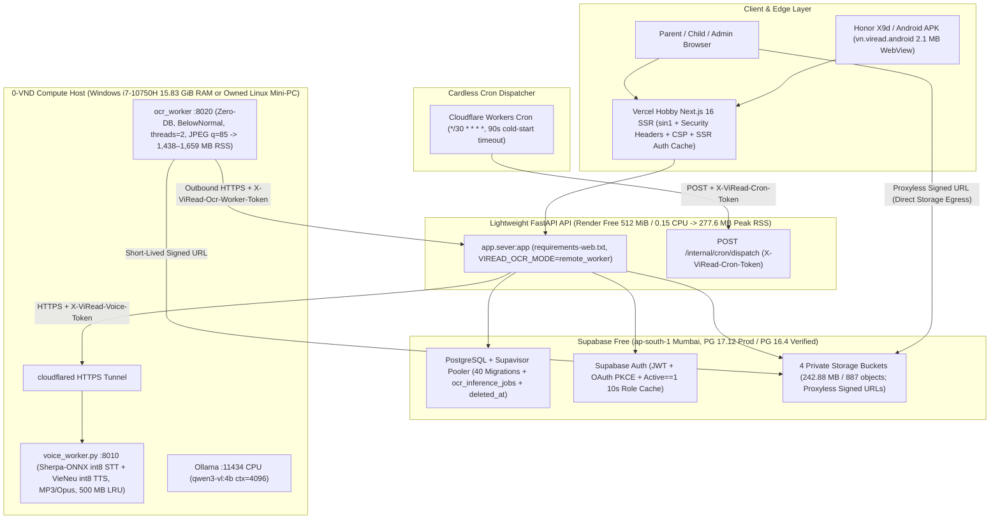

# 02. Current Architecture Audit (ViRead Baseline & RC Baseline `d5eee4dc..RC`)

> **Audit Scope:** Production live reference (`origin/main` `94fffd29e3bcef81c034f4ec4db65b9120b686f2`, `https://viread-frontend.vercel.app`, `https://capstone1-ssd8.onrender.com`, Supabase `akjxbkakbbabpblmsktm`), Staging (`c42f10e3e81079bc0a53a7313cd0bdd6b6f69a01`), and Integrated Release Candidate worktree `F:\c1\capstone1-rc-zero-cost` (`feat/viread-rc-zero-cost-20261125` atop merge baseline `d5eee4dc907d81b737b53da08c916b1b4ba095d3`).  
> **Invariants Preserved:** `backend/requirements.txt` ABI pins untouched (`numpy==1.26.4`, `protobuf==3.20.2`, `opencv-python-headless==4.10.0.84`, `pytesseract==0.3.13`), entrypoint `backend/app/sever.py` (`app.sever:app`) preserved, `F:\c1\capstone1` & `F:\c1\capstone1-staging-release` untouched.

---

## 1. System Topology: Baseline (`main`) vs RC Hardened (`feat/viread-rc-zero-cost-20261125`)

---

## 2. Read-Only Production Baseline Snapshot (`akjxbkakbbabpblmsktm`, Checked `2026-11-25`)

| Dimension | Measured Production State (`v2` / RC Verification) | Operational Implication |
|---|---|---|
| **Supabase Project & PG** | `akjxbkakbbabpblmsktm` (`ViRead`, `ap-south-1`, PG `17.12`) | Colocated with Vercel `sin1` SSR; PG `17.12` > local PG `16.4` CI |
| **Database Size** | `33,568,435 B` (`~33.57 MB` / `500 MB` limit = `6.7%`) | Ample DB storage headroom; Supavisor pooler mandatory on Render |
| **Storage Footprint** | `242,883,950 B` (`~231.6 MB`) across `887` objects (`4` private buckets) | Fits `1 GB` Free tier; historical cleanup resolved prior `1.96 GB` spike |
| **Schema Version Drift** | `has_books_deleted_at = true`, `has_ocr_jobs_table = false` (`11` active books, `1` deleted, `3` private, `0` checking) | Prod already has soft-delete migration (`94fffd29`); **MUST apply `20261124010000_ocr_inference_jobs.sql` before RC Render cutover** |
| **Leaked Password Protection** | Disabled (`Supabase Free` plan gate) | Requires Supabase Pro (`$25/mo`) or remains accepted academic risk (`BLOCKED` at `0 VND`) |

---

## 3. Codebase & Subsystem Inventory (Current RC Worktree)

### A. Backend (`backend/`, 21 Mounted Route Modules + `sever.py`, `235` Unique OpenAPI Paths, `0` Duplicate Warnings)
1. **Authentication, RBAC & Rate Limiting:**
   - `backend/app/api/deps.py` (`get_current_parent_id`, `require_active_profile_id`) + `backend/app/database/role_cache.py` (process cache with `VIREAD_ROLE_CACHE_TTL_SECONDS=10.0` default + `invalidate_cached_role()` called on `AdminParentRepository.soft_delete_parent`). Closes the baseline gap where `/voice/*` and `/support/feedback` skipped `Active == 1` DB checks.
   - `backend/app/services/rate_limiter.py`: sliding-window `429` limits on OCR scan/match/voice/feedback endpoints.
2. **OCR Queue, Adjudication & Outbox:**
   - `backend/app/api/routes/internal_ocr.py`, `backend/app/services/ocr_inference_job_service.py`: `FOR UPDATE SKIP LOCKED` job claiming, monotonic `fencing_token` anti-split-brain, `409 BOOK_SOFT_DELETED` fencing, tenant-scoped `OwnerUserId` SHA-256 OCR cache.
   - `ocr_engine.py` (`_sanitize_vietocr_prediction`, `is_vietocr_reliable`) & `ocr_adjudication.py` (`adjudication_token`): strip `<pad>`, `<sos>`, `<eos>`, `<unk>` tokens while preserving `FLOW1_EXTERNAL_TRDG` (`200edce4...`).
   - **RC Postgres Fix:** `backend/app/services/admin_ocr_service.py:2851` updated `ON CONFLICT (event_type, revision_id) WHERE event_type = 'VERIFIED_REVISION' DO NOTHING` to match partial unique index `uq_viread_ocr_outbox_verified_revision` created in `20261122120000_parent_private_book_flow2_contribution.sql`.
3. **Egress, Storage & Rasterization Optimization:**
   - `backend/app/policies/book_access.py`: switches private book images to proxyless Supabase Storage signed URLs (`ParentPrivateBookService` fixed to read `sub.SourceStoragePath`).
   - `backend/app/services/document_rasterizer_service.py`: defaults rasterized page output to JPEG `quality=85` (`-62.0%` to `-90.4%` payload reduction, improved CER `0.017001`).
   - `backend/app/routes/reading.py`: enforces `12 MB` `413` streaming upload cap on `/match-page` and `120/60` candidate query bounds.
4. **Workers & Cardless Scheduled Dispatch:**
   - `backend/app/sever.py` + `parent_book_submission_worker.py` (`only_post_ocr=True`): decouples lightweight post-OCR, `viread_ocr_outbox_worker`, and `viread_ocr_training_auto_worker` cleanly without loading `torch`/`paddle`.
   - `backend/app/api/routes/internal_cron.py` (`POST /internal/cron/dispatch` guarded by `X-ViRead-Cron-Token` `hmac.compare_digest` fail-closed `503`/`401`) + `--once` + PostgreSQL advisory locks in `reading_reminder_worker.py` & `reading_presence_alert_worker.py`.
   - `infra/cloudflare-cron/{wrangler.toml, src/index.js}`: cardless Cloudflare Workers Cron set to `*/30 * * * *` (allowing Render Free `15m` idle sleep under `750h` pool) with `90,000 ms` cold-start timeout.
5. **Voice Worker (`scripts/windows/voice_worker.py` & `backend/app/services/voice.py`):**
   - Persistent `httpx.AsyncClient` connection pooling + `local_voice_worker_bootstrap.py` (`-ReplaceIncompatibleWorker`).
   - Content-negotiated `Accept: audio/mpeg` (`11.74x` smaller) & `audio/ogg` (`11.27x`–`26.33x` smaller) + `prune_tts_cache_dir()` (`500 MB` LRU cap).

### B. Frontend (`frontend/`, Next.js `16.3.4` Turbopack, `55` App/Route Files, `39` Prerendered Routes)
- `next.config.ts`: `resolveTurbopackRoot()` + `X-Content-Type-Options: nosniff`, `X-Frame-Options: DENY`, `Referrer-Policy`, `Permissions-Policy: camera=(self), microphone=(self)`, and `Content-Security-Policy`.
- `app/auth/callback/route.ts`: explicit origin allowlist blocking `Host`/`X-Forwarded-Host` header spoofing.
- `components/admin/admin-health-screen.tsx`: per-worker operational telemetry (`queue_depth`, `oldest_pending_job_age_seconds`, `last_success_at`, `last_error`).
- `lib/reading/local-segment-speech-recognition.ts` & `lib/reading/tts-audio-format.ts`: VAD/pause-gated interim STT throttling (`sttCircuitOpen`) + MP3/Ogg client preference with WAV fallback.
- Ported clean pagination (`pagination-bar.tsx`), responsive tables (`responsive-table.tsx`), reading auto-scroll (`use-reading-auto-scroll.ts`), and `F:\c1\capstone1` UI polish hunks.

### C. Standalone Workers & Mobile (`ocr_worker/`, `android/`, `ai/`)
- `ocr_worker/Dockerfile` & `docker-compose.yml`: hardened `USER appuser`, CPU PyTorch wheel index, `--no-deps` `paddleocr==2.7.3` with `opencv-python-headless==4.10.0.84` verified as sole `cv2` owner in WSL2 Linux `x86_64`, plus `ocr_text_utils.py` container sync.
- `android/`: `2.1 MB` APK (`vn.viread.android`, `minSdk 26`, `targetSdk 35`, `NO_NATIVE_LIBS`), release builds forbid LAN endpoint overrides (`ServerEndpointStore`), camera/mic WebRTC restricted to trusted HTTPS origin. (`android/OFFLINE_POC_ARCHITECTURE.md` documents native Sherpa/TFLite roadmap without altering current APK.)

---

## 4. Known Residual Constraints Audited Honestly

1. **Duplicate Operations Resolved:** `POST /books/admin/catalog` conflict in `admin_ocr.py` removed (`235` paths, `0` warnings).
2. **Pre-existing Service Deviations Remaining (Documented, Low Risk):** `reading.py:692,816` still queries `BookPage`/`Book` directly in route; `runtime_diagnostics.py:253` executes read-only aggregate SQL in service.
3. **Ephemeral & Standalone Boundaries:** `/ai-correct/jobs` in-memory tasks reset on Render sleep/restart; `karaoke_processing_worker` stays manual CLI (`KARAOKE_PROCESSING_ENABLED=false`) due to heavy Demucs/CTC footprint (`>= 4 GB` RAM).
4. **Public Catalog `?token=` URLs:** `book_service.py` & `reading_content_service.py` still emit `?token=` URLs from Supabase private buckets (`Supa Uncached` egress); Option 5's public CDN bucket shift is `DOCUMENTED BUT NOT TESTED` post-RC work.
